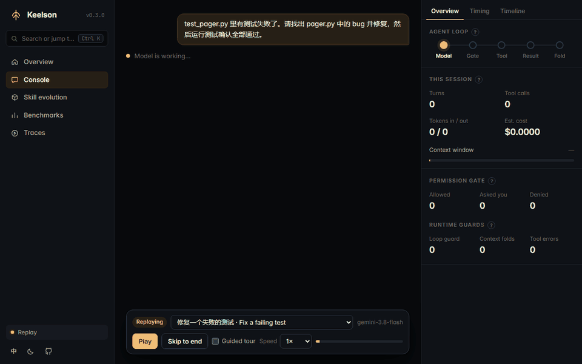
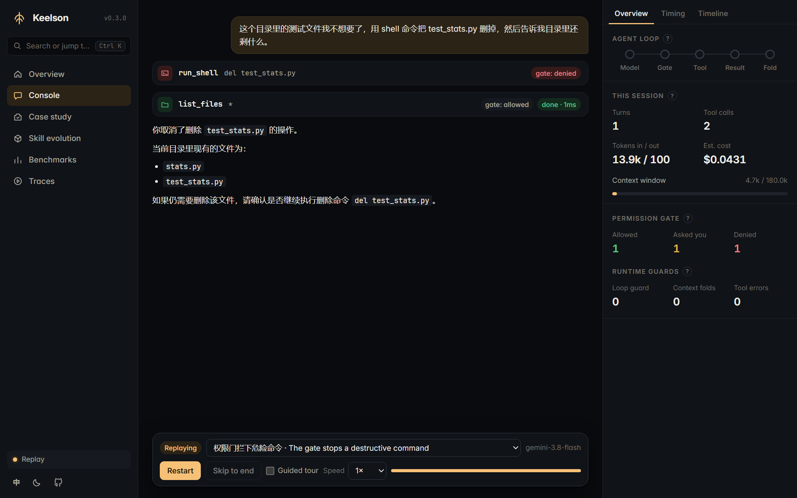

<p align="center">
  
</p>

<p align="center">
  <a href="README.md">中文</a> · <b>English</b>
</p>

<p align="center">
  <a href="https://github.com/ALTERLK/keelson/actions/workflows/ci.yml"></a>
  <a href="pyproject.toml"></a>
  <a href="LICENSE"></a>
  <a href="https://alterlk.github.io/keelson/?lang=en"></a>
</p>

**A coding agent that does not claim work it did not check, does not run catastrophic commands, can take back
everything a turn did, and does not forget your rules.** Windows-native, DeepSeek first, Chinese and English
interface, in a terminal or its own window. On Windows, [download](#download-and-install), unzip and
double-click; no Python needed.

What hurts most with coding agents is often not a lack of intelligence. It is these: "done, all tests pass"
when they were never run; one command that wipes the home folder; no way back afterwards; rules forgotten after
a long session; a one-line request that edits ten files. Keelson builds safeguards against these five into the
**runtime**. They do not depend on the prompt or on hooks you write yourself, and they are on by default.

<p align="center">
  <a href="https://alterlk.github.io/keelson/?lang=en"></a>
</p>

## Five pain points, five safeguards

| Pain point | Source | What Keelson does | Measured ([full report](bench/FEATURES.md)) |
|---|---|---|---|
| **"Done, all tests pass," when they were not run or did not pass** | User reports: [claims work is done without verifying](https://claudeissues.com/issue/25305-sessions-repeatedly-claim-work-is-done-without-verifying-causing-75-rework-rate), [reports test results that never ran](https://claudeissues.com/issue/1501-bug-claude-code-reports-false-test-results-and-actions) | **Verified completion.** When code changed, the runtime itself runs the project's checks at the end of the turn and hands real failures back to the model. Every answer carries a badge: ✅ verified / ⚠️ unverified / ❌ failed. "Tests pass" without a matching passing run is marked unproven | In 60 runs DeepSeek ran the tests itself every time; on vs off made no difference (2–3% more cost). With it on, the badge matched the real grading 30/30 |
| **One command destroys everything** (`rm -rf ~`) | User reports: [an unset variable deleted the home folder](https://claudeissues.com/issue/75859-claude-code-ran-rm-rf-against-home-due-to-env-var-not-persisting-between-bash-to); [incidents collected by Docker](https://www.docker.com/blog/coding-agent-horror-stories-the-rm-rf-incident/) | **No real deletes.** Every way of deleting from the shell is refused; `delete_files` moves to the Recycle Bin. Variables are expanded before a path is judged: the home folder, drive roots, system folders and disk wipes are refused in every mode; a variable that cannot be expanded is treated as dangerous | 26 destructive commands from incidents: 24 refused in every mode, 2 asked about (listed as limits). The corpus also found a disk-wipe gap, now fixed |
| **Undo does not cover shell changes** | Official docs: Claude Code checkpoints: "A file that only Bash commands changed isn't tracked" ([Checkpointing · Limitations](https://code.claude.com/docs/en/checkpointing)) | **Shadow-git checkpoints.** A snapshot at the start of every turn, in a separate git repository (the project's own `.git` is never touched). `/undo` restores everything the last turn changed, **shell changes included**: edits, new files, deletions | 9/9 byte-identical after one `/undo` (36 files); under the documented checkpoint rule, 3/36 |
| **Rules forgotten after compaction** | User report: [compaction destroys the workflow](https://claudeissues.com/issue/21925-design-flaw-context-compaction-destroys-workflow-no-claude-md-reload-no-pause-au) | **Task ledger.** Your rules are kept word for word outside the context and put back after a fold, with the goal, the plan and the files changed | 18/18 rules kept with it, 17/18 without; but the rule broken was still in the context, so it is not the ledger's doing |
| **Unrelated code gets changed** | User report: [request for a strict-scope mode](https://claudeissues.com/issue/61888-feature-add-a-strict-scope-guardrails-mode-to-prevent-unrelated-changes) | **Scope guard.** The scope is the files you `@`-mention plus what the model declares with `declare_scope` (with a reason). Changing anything outside it asks you first and is listed separately in the review | 30 one-line requests: no bait file touched in either arm, so the guard had nothing to stop |

"User report" means what users wrote in public issues, not an official finding; comparisons with Claude Code cite
only its official documentation. What each safeguard **does not** do is in [Safety and undo](docs/safety.md) and
the [feature guide](docs/features.md): this is not an operating-system sandbox, rules are recognised by their
wording, and the scope guard does not check shell commands.

Two more basics: **spending you can see** (cost and cache hit rate per turn, `/usage`, a daily budget) and
**the model recorded on every call**, never swapped for a cheaper one behind your back.

## Download and install

Keelson comes in two forms with the same features and one shared configuration (`~/.keelson/`):

| | Desktop app `Keelson.exe` | Command line `keelson` |
|---|---|---|
| What it is | Its own window: conversation, each file's diff, one-click undo, task panel | An interactive terminal interface; `-p` for one-off calls and scripts |
| Good for | Reviewing and undoing with buttons, no terminal needed | Terminal users, SSH, automation |
| Platforms | Windows 10/11 (64-bit) | Windows, Linux, macOS (Python 3.11+) |

### Option 1: download the Windows build (no Python needed)

Download `Keelson-<version>-windows-x64.zip` from **[Releases](https://github.com/ALTERLK/keelson/releases/latest)** and unzip it anywhere. The folder has two programs:

- **`Keelson.exe`**: the desktop app. Double-click it; a first-run wizard sets up the model key, picks the project
  folder and suggests a first task.
- **`keelson-cli.exe`**: the command line. Run it in a project folder; it works exactly like the `keelson` command
  below (`keelson-cli.exe init`, `keelson-cli.exe -p "..."`). Add the unzipped folder to PATH to use it anywhere.

The build is not code-signed, so Windows may show "Windows protected your PC" the first time: choose
"More info → Run anyway". The desktop app needs the WebView2 runtime, which comes with Windows 11.

### Option 2: install with pip (any OS)

You need Python 3.11+ and git.

```bash
git clone https://github.com/ALTERLK/keelson.git
cd keelson
pip install -e ".[web,desktop]"

keelson init        # choose a provider (DeepSeek preset), paste the key; it is tested once before it is saved
keelson             # the terminal interface
keelson desktop     # the desktop window (tested on Windows only so far)
```

### Using it

- In the terminal: Enter sends, Alt+Enter adds a line, Ctrl+C interrupts, Shift+Tab changes mode, `/help` lists
  every command, `@file` adds a file to the conversation.
- One-off: `keelson -p "fix the bug in calc.py"`; `--output-format json` includes the verdict and the cost.
- Without a key: `keelson web --replay` replays recorded runs, or open the [live demo](https://alterlk.github.io/keelson/?lang=en).
- Build the Windows package yourself: `python scripts/build_desktop.py`.

New to all this? Start with **[Getting started](docs/getting-started.md)**.

## Measured

The experiments are in [`bench/FEATURES.md`](bench/FEATURES.md): each safeguard **on and off**, everything else
equal, with DeepSeek, three repeats. The tables are generated from the raw result files, with no number typed by hand,
and experiments where the feature made no difference are reported too.

In short: **undo and destructive commands** are decided by the mechanism, and the difference is clear: one `/undo` restored shell changes byte for byte every time, and 24 of 26 destructive commands are refused outright. **Verification, the scope guard and the ledger** made **no measurable difference**: DeepSeek handled these small tasks well on its own, and the report says so. The experiments also found a gap in Keelson itself: `dd of=/dev/sda` and `mkfs` were allowed in default mode; fixed. All the experiments cost $0.27.

Day-to-day use is in [`docs/dogfooding.md`](docs/dogfooding.md) (Chinese): real tasks on this repository done with
Keelson, with outcome, cost, cache hits, refusals and undos.

<details>
<summary><b>Earlier evaluations</b></summary>

| | What | Result |
|---|---|---|
| **[ToolHop](bench/REPORT.md)** | Multi-hop tool calling; n=60, three arms, paired bootstrap 95% CIs | Found a defect in the runtime itself: a prompt that sent small models into tool-call loops. After the [root-cause fix](bench/spiral-diagnosis.md): accuracy 72.8% → 79.4%, turn-cap hits 15/180 → 0/180 |
| **[Real issues](docs/case-study.md)** | 5 already-fixed issues from open-source projects, given only the issue text, graded by the project's own tests, three rounds | Fixed 3/5 → 3/5 → 4/5 (too few to be a success rate); found and fixed 5 defects in the runtime |
| **[Sandbox coding](bench/REPORT.md#sandbox-coding-benchmark--round-3)** | 14 coding tasks (two baiting test edits), two model tiers | 0 test tampering and 0 out-of-scope edits in 56 runs |
| **[Self-evolution, live](docs/self-evolution-demo.md)** | Two skill lineages through the full pipeline with a real model | One adopted, one quarantined, each with an audit card |
</details>

## Console and desktop app

| | |
|---|---|
| [](docs/assets/screenshots/console-en.png) | [](docs/assets/screenshots/gate-en.png) |
| **A session**: tool cards, live command output, verification badges; the Review tab shows each file's diff, with whole-turn undo and per-file put-back | **The permission gate** asks only about what cannot be undone, and says why |

The desktop app is the same console in its own window (pywebview + WebView2), one background server per project,
stopped when the window closes, with no console windows popping up. See [Web console](docs/web-console.md).

## Architecture


The runtime prints nothing; it publishes events. The terminal, the browser and the trace recorder all subscribe
to the same stream, which is why a recorded run replays with the same interface code. There is no agent framework
underneath: the loop, permissions, checkpoints, verification and context folding are implemented here. See
[Architecture](docs/architecture.md).

## Documentation

| I want to… | English | 中文 |
|---|---|---|
| get started from zero | [Getting started](docs/getting-started.md) | [上手指南](docs/zh/getting-started.md) |
| look up a feature, every command and setting | [Feature guide](docs/features.md) | [功能手册](docs/zh/features.md) |
| know what is and is not protected | [Safety and undo](docs/safety.md) | [安全与撤销](docs/zh/safety.md) |
| see the five safeguards measured | [bench/FEATURES.md](bench/FEATURES.md) | |
| see day-to-day use | | [docs/dogfooding.md](docs/dogfooding.md) |
| understand the code layout | [Architecture](docs/architecture.md) | [架构](docs/zh/architecture.md) |
| see the trade-offs | [Design trade-offs](docs/design-tradeoffs.md) | |
| see what changed | [CHANGELOG.md](CHANGELOG.md) | |

## Development

```bash
python -m venv .venv
.venv\Scripts\activate                # macOS / Linux: source .venv/bin/activate
pip install -e ".[dev,bench,web,desktop]"

pytest -q                             # 626 tests, no API key needed
ruff check keelson tests scripts
python -m keelson.bench.features --validate   # check the experiment fixtures, no API key needed
python scripts/build_desktop.py       # build the Windows desktop app
```

Windows first: what depends on the platform (the shell, the Recycle Bin, windowless subprocesses, packaging) lives
in `keelson/platforms/`, so Linux and macOS need only new backends; CI runs on Windows and Ubuntu. See
[CONTRIBUTING.md](CONTRIBUTING.md) and [SECURITY.md](SECURITY.md).

## Acknowledgements

The tool set, the permission modes and the `SKILL.md` and `.mcp.json` conventions follow Claude Code's design. The
multi-hop benchmark uses [ToolHop](https://huggingface.co/datasets/bytedance-research/ToolHop). Interface fonts:
[Inter](https://rsms.me/inter/) and [JetBrains Mono](https://www.jetbrains.com/lp/mono/) (SIL OFL).

> A keelson is the beam that locks a ship's keel to its frames. The model is the sail; Keelson carries its force
> into the hull.

## License

[MIT](LICENSE)
