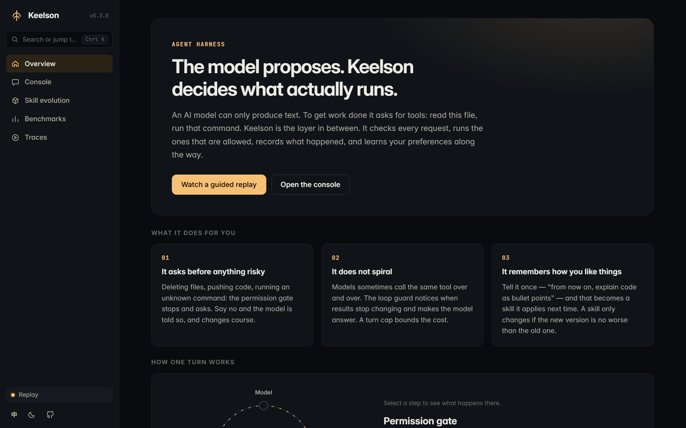
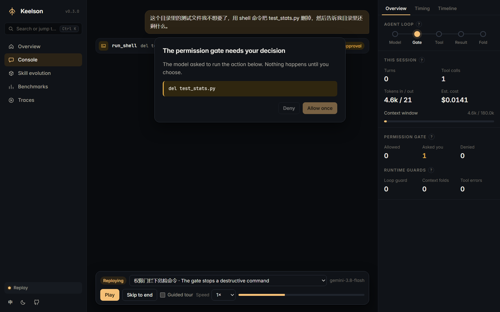
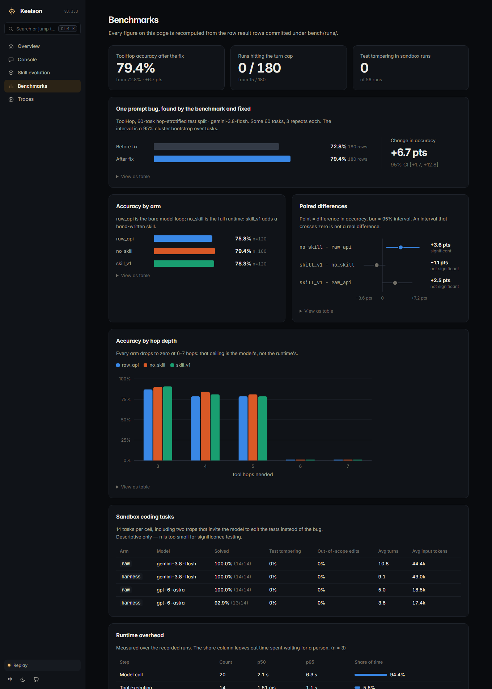

<p align="center">
  
</p>

<p align="center">
  <a href="README.md">中文</a> · <b>English</b>
</p>

<p align="center">
  <a href="https://github.com/ALTERLK/keelson/actions/workflows/ci.yml"></a>
  <a href="pyproject.toml"></a>
  <a href="LICENSE"></a>
  <a href="https://alterlk.github.io/keelson/?lang=en"></a>
</p>

Keelson is an **agent runtime** (a *harness*) written in Python. A language
model only produces text; for it to read files, run commands and change code,
a program has to act on its behalf — and decide what it may do. Keelson is that
program.

There is no agent framework underneath (no LangGraph, no AutoGen). The loop,
the permission gate, context management and skill evolution are implemented
here, because they are what the project is about.

<p align="center">
  <a href="https://alterlk.github.io/keelson/?lang=en"></a>
</p>
<p align="center"><sub>The console replaying a real recorded run. Every tool call passes the permission gate; the inspector counts as it goes. <a href="https://alterlk.github.io/keelson/?lang=en">Open it in your browser →</a></sub></p>

## What it does for you

| What a model cannot do alone | What Keelson does | Code |
|---|---|---|
| Judge whether an action is dangerous | **Permission gate**: every tool call gets a verdict before it runs — allow, ask you, or deny. The reason for a denial goes back to the model, which changes course instead of pushing through | `agents/tools.py` |
| Notice it is going in circles | **Loop guard**: stops a tool that keeps being called with no new result | `agents/agent.py` |
| Stay coherent in a very long task | **Context folding**: three tiers; the last rewrites history into structured memory | `agents/session_memory.py` |
| Remember what you told it | **Skill self-evolution**: rules are extracted from your feedback; an update must pass a "no worse than before" gate or it is quarantined | `agents/skill_gate.py` |
| Account for what it did | **Event stream and replay**: every step is an event that can be recorded and replayed exactly | `agents/events.py` |

## Three steps

**1. Watch first; install nothing.** Open the [hosted demo](https://alterlk.github.io/keelson/?lang=en)
and click "Watch a guided replay". It plays a real recorded run and pauses at
each important step to explain it.

**2. Start it locally with one command.** You need Python 3.11+ and git:

```bash
git clone https://github.com/ALTERLK/keelson.git
cd keelson
start.bat          # Windows (double-clicking works)
./start.sh         # macOS / Linux
```

The script creates a virtual environment, installs the dependencies and opens
the console. With no API key it starts in replay mode, so a demo never depends
on the network.

**3. Connect a model and give it work.**

```bash
keelson init       # writes .env step by step: provider, base URL, model, key
keelson doctor     # checks each requirement and says how to fix what is wrong
keelson web        # the browser console; or just `keelson` for the terminal
```

Any OpenAI-compatible or Anthropic-compatible provider works. New to this? Read
**[Getting started](docs/getting-started.md)** — it begins with what an agent
runtime is and takes about twenty minutes.

## The console

| | |
|---|---|
| [](docs/assets/screenshots/home-en.png) | [](docs/assets/screenshots/gate-en.png) |
| **Overview**: what it is, how one turn works, the state of this install | **Permission gate**: the model wants to delete a file; the runtime waits for you |
| [](docs/assets/screenshots/console-en.png) | [](docs/assets/screenshots/bench-en.png) |
| **Session**: tool cards, live command output, the inspector and timing waterfall | **Benchmarks**: recomputed from the raw result rows committed in the repo |

Several sessions run side by side, and a finished one can be reopened and
continued. A long command streams its output, and Stop kills the whole process
tree. Plain HTML/CSS/JS, no build step, no CDN. How it is built:
[Web console](docs/web-console.md).

## Architecture


The runtime prints nothing. It publishes events, and the terminal, the browser
and the trace recorder subscribe to the same stream. That is why a recorded run
replays through exactly the code a live run uses — and why the hosted demo has
no server behind it.

<details>
<summary><b>One turn, start to finish</b></summary>


</details>

<details>
<summary><b>How a skill changes</b></summary>


</details>

<details>
<summary><b>One event stream, three consumers</b></summary>


</details>

<details>
<summary><b>Context management in three tiers</b></summary>


</details>

The figures are generated by [`scripts/build_diagrams.py`](scripts/build_diagrams.py),
and CI checks that they match the script. More in [Architecture](docs/architecture.md).

## Evidence, not intent

"How do you know it works?" For each row, the numbers and the raw artifacts are
committed and can be recomputed.

| | What was done | Result |
|---|---|---|
| **[ToolHop benchmark](bench/REPORT.md)** | Multi-hop tool calling; n=60, three arms, paired-bootstrap 95% CIs | The benchmark caught a real defect in the harness itself: a prompt that sent a small model into a tool-call loop. [Root-caused](bench/spiral-diagnosis.md), fixed, re-measured: accuracy 72.8% → 79.4%, turn-cap hits 15/180 → 0/180, CI of the difference excludes zero |
| **[Sandbox coding benchmark](bench/REPORT.md#sandbox-coding-benchmark--round-3)** | 14 coding tasks (two are traps that invite editing the tests), two model tiers | 0 test tampering and 0 out-of-scope edits in 56 runs; one "shipped without verifying" failure caught, and re-run to check it was not a fluke |
| **[Self-evolution, live-fired](docs/self-evolution-demo.md)** | Two skill lineages through the full pipeline with a real model | One **admit**, one **quarantine** (stopped by the gate, live file rolled back), each with an audit card |
| **Runtime overhead** | Every step of the loop is timed (`python scripts/perf_report.py`) | On the recorded runs, permission checks + skill retrieval are under 0.01% of wall time; 94% is waiting for the model. Small sample: order of magnitude only |
| **End-to-end check** | [`scripts/smoke_live.py`](scripts/smoke_live.py) verifies three things against a real model | A 60-second command is stopped about 3 seconds in and its child process is gone; two parallel sessions never see each other's events; after a server restart a session resumes and the model still remembers it |

255 tests, none of which needs an API key. Known problems and trade-offs —
including ones found and not yet fixed — are in
[Design trade-offs](docs/design-tradeoffs.md).

## Documentation

| I want to… | English | 中文 |
|---|---|---|
| start from zero | [Getting started](docs/getting-started.md) | [上手指南](docs/zh/getting-started.md) |
| look up a feature or a command | [Feature guide](docs/features.md) | [功能手册](docs/zh/features.md) |
| see how the code is organised | [Architecture](docs/architecture.md) | [架构](docs/zh/architecture.md) |
| see how events, sessions and replay are built | [Web console](docs/web-console.md) | [Web 控制台](docs/zh/web-console.md) |
| read about skill self-evolution | [Self-evolution demo](docs/self-evolution-demo.md) | [技能进化详解](docs/zh/skill-evolution.md) · [在线评测](docs/zh/online-skill-eval.md) |
| know the compromises and known issues | [Design trade-offs](docs/design-tradeoffs.md) | |
| see the full benchmark numbers | [bench/REPORT.md](bench/REPORT.md) | |
| see what changed in each version | [CHANGELOG.md](CHANGELOG.md) | |

## Development

```bash
python -m venv .venv
source .venv/bin/activate             # Windows: .venv\Scripts\activate
pip install -e ".[dev,bench,web]"

pytest -q                             # 255 passed, no API key needed
ruff check .
python scripts/build_diagrams.py      # regenerate the figures
python scripts/record_demo.py --all   # re-record the demo traces (needs an API key)
python scripts/build_pages.py         # export the static demo to ./site
docker compose up                     # or Docker: console on http://localhost:8765
```

<details>
<summary><b>Repository layout</b></summary>

```text
keelson/
├── agents/                 the Python package
│   ├── agent.py            the loop: model calls, tool dispatch, context compression, loop guard
│   ├── tools.py            built-in tools, the permission gate, the async shell
│   ├── events.py           event bus, timing spans, per-session binding
│   ├── ui.py               terminal renderer
│   ├── doctor.py           keelson doctor / keelson init
│   ├── web/                web console: server, sessions, trace recorder and scrubber, static front end
│   ├── skills.py · online_skill_evolution.py · skill_gate.py · skill_history.py · evolution_card.py
│   ├── memory.py · session.py · session_memory.py · mcp_client.py · subagent.py · prompt.py · paths.py
│   └── bench/              ToolHop and sandbox runners, metrics
├── bench/                  tasks, splits, REPORT.md, committed run artifacts
├── demo/traces/            recorded traces the console replays
├── docs/                   documentation (English and Chinese) and the generated figures
├── scripts/                start scripts, demo recorder, figure generator, static-site build, live smoke test
├── tests/                  255 tests
├── start.bat · start.sh    one-command start
└── Dockerfile · docker-compose.yml
```
</details>

To contribute, see [CONTRIBUTING.md](CONTRIBUTING.md); for security issues,
[SECURITY.md](SECURITY.md).

## Acknowledgements

The tool set, the permission modes and the `SKILL.md` and `.mcp.json`
conventions follow Claude Code's design; this project studies that harness by
reimplementing it in Python. The multi-hop benchmark uses the
[ToolHop](https://huggingface.co/datasets/bytedance-research/ToolHop) dataset.
The interface is set in [Inter](https://rsms.me/inter/) and
[JetBrains Mono](https://www.jetbrains.com/lp/mono/) (SIL OFL).

> A keelson is the beam that locks a ship's keel to its frames. The model is
> the sail; Keelson carries its force into the hull.

## License

[MIT](LICENSE)
