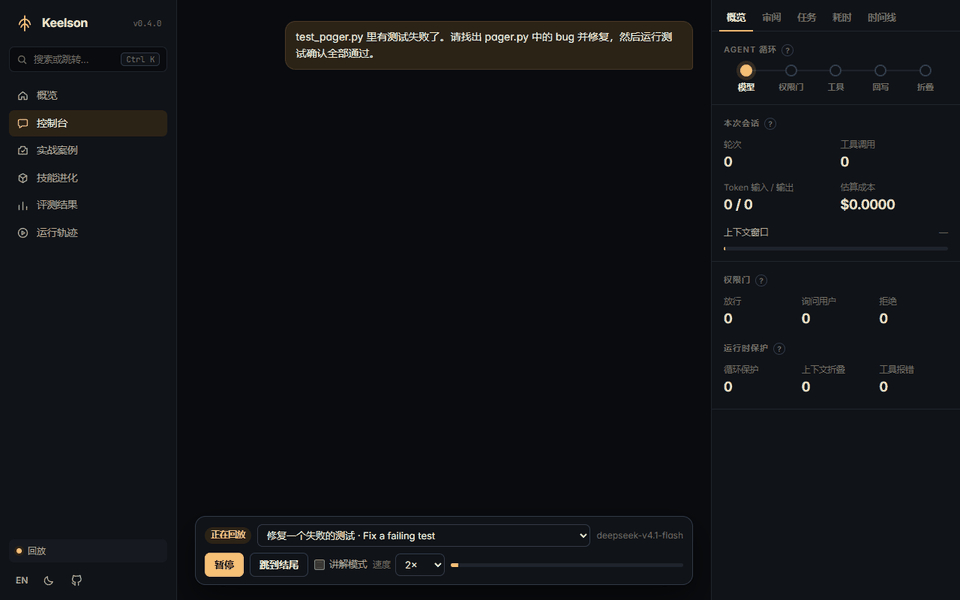
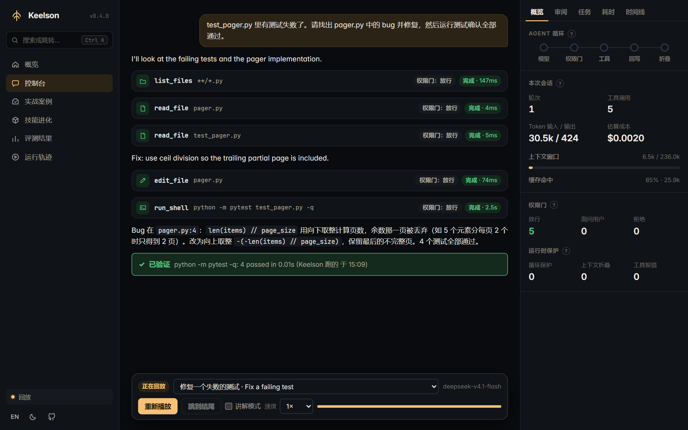

<p align="center">
  
</p>

<p align="center">
  <b>中文</b> · <a href="README.en.md">English</a>
</p>

<p align="center">
  <a href="https://github.com/ALTERLK/keelson/actions/workflows/ci.yml"></a>
  <a href="pyproject.toml"></a>
  <a href="LICENSE"></a>
  <a href="https://alterlk.github.io/keelson/?lang=zh"></a>
</p>

**一个不会骗你、不会闯大祸、能完整撤销、不会失忆的编码 Agent。** Windows 原生，DeepSeek 优先，中文界面，终端和桌面窗口都能用：Windows 上[下载](#下载与安装)解压就能双击运行，不用装 Python。

编码 Agent 最让人头疼的，往往不是“不够聪明”，而是这几件事：说做完了其实没做完；一条命令删光了主目录；出事以后撤不回来；聊久了忘了你定的规矩；让它改一行，它顺手改了十个文件。Keelson 把对这五件事的保障做进**运行时**：不靠提示词，也不用你自己写钩子，默认就开着。

<p align="center">
  <a href="https://alterlk.github.io/keelson/?lang=zh"></a>
</p>

## 五个痛点，五个保障

| 痛点 | 依据 | Keelson 的做法 | 实测（[完整报告](bench/FEATURES.md)） |
|---|---|---|---|
| **说“做完了、测试都过了”，其实没跑或没过** | 用户反馈：[声称完成却没验证](https://claudeissues.com/issue/25305-sessions-repeatedly-claim-work-is-done-without-verifying-causing-75-rework-rate)、[报告了从未执行的测试结果](https://claudeissues.com/issue/1501-bug-claude-code-reports-false-test-results-and-actions) | **完工验证**：改了代码，轮末由运行时自己跑项目的检查命令；失败就把真实输出交还模型继续修。结论前挂徽章：✅ 已验证 / ⚠️ 未验证 / ❌ 未通过。模型说“测试通过”却没有对应的成功记录，标成“未经证实” | 60 次运行里 DeepSeek 每次都自己跑了测试，开和关没有差别（多花 2–3%）；开启时徽章结论 30/30 与真实判分一致 |
| **一条命令毁掉一切**（`rm -rf ~`） | 用户反馈：[环境变量没传下去，删了主目录](https://claudeissues.com/issue/75859-claude-code-ran-rm-rf-against-home-due-to-env-var-not-persisting-between-bash-to)；[Docker 博客整理的事故](https://www.docker.com/blog/coding-agent-horror-stories-the-rm-rf-incident/) | **没有真删除**：shell 里的各种删除方式一律拒绝，改用 `delete_files` 进回收站。展开变量后再判断路径：主目录、盘符根、系统目录、擦盘命令在任何模式下都拒绝；无法展开的变量按危险处理 | 26 条照事故写的毁灭性命令：24 条任何模式都拒绝，2 条会询问（写明在局限里）；实验还抓到了擦盘命令的漏洞，已修 |
| **撤销管不到 shell 命令的改动** | 官方文档：Claude Code 的检查点“A file that only Bash commands changed isn't tracked”（[Checkpointing · Limitations](https://code.claude.com/docs/en/checkpointing)） | **影子 git 检查点**：每轮开始给项目拍快照（独立的 git 仓库，不碰项目自己的 `.git`）。`/undo` 还原上一轮全部改动，**包括 shell 造成的**修改、新建和删除 | 9/9 次逐字节还原（36 个文件）；按官方文档的规则，只有 3/36 能撤回 |
| **压缩之后忘了约束** | 用户反馈：[压缩毁掉工作流](https://claudeissues.com/issue/21925-design-flaw-context-compaction-destroys-workflow-no-claude-md-reload-no-pause-au) | **任务账本**：你说过的规则按原话保存在上下文之外，折叠后原样放回，连同目标、计划和改过的文件 | 有账本 18/18 条规则守住，没有 17/18；但违反的那次规则仍在上下文里，不算账本的功劳 |
| **自作主张改无关代码** | 用户反馈：[请求“严格范围模式”](https://claudeissues.com/issue/61888-feature-add-a-strict-scope-guardrails-mode-to-prevent-unrelated-changes) | **范围护栏**：范围是你 `@` 的文件加上模型用 `declare_scope` 声明的（附理由）；改范围外的文件要先问你，审阅时单独列出 | 30 次一行请求，两组都没碰无关文件，护栏没有出手的机会 |

“用户反馈”指公开 issue 里用户的描述，不是官方结论；与 Claude Code 的对比只引用它的官方文档。每一项的**做不到什么**写在 [安全与撤销](docs/zh/safety.md) 和 [功能手册](docs/zh/features.md) 里，例如：这不是操作系统级沙箱；规则靠措辞识别；护栏不检查 shell 命令。

另外两条底线：**花了多少钱看得见**（每轮花费、缓存命中率、`/usage` 汇总、每日预算上限），**用的是哪个模型写在记录里**，不会悄悄换成便宜的。

## 下载与安装

Keelson 有两种用法，功能相同，共用同一份配置（`~/.keelson/`）：

| | 桌面窗口版 `Keelson.exe` | 命令行版 `keelson` |
|---|---|---|
| 样子 | 独立窗口：对话、每个文件的 diff、一键撤销、任务面板 | 终端里的交互界面；也能用 `-p` 一次性调用，接进脚本 |
| 适合 | 不想碰终端，想点按钮审阅和撤销 | 习惯终端，或者用在 SSH、自动化里 |
| 平台 | Windows 10/11（64 位） | Windows、Linux、macOS（Python 3.11+） |

### 方式一：下载 Windows 版（不用装 Python）

从 **[Releases](https://github.com/ALTERLK/keelson/releases/latest)** 下载 `Keelson-版本号-windows-x64.zip`，解压到任意位置。文件夹里有两个程序：

- **`Keelson.exe`**：桌面窗口版。双击打开，首次运行的向导会带你填模型 Key、选项目文件夹、派出第一个任务。
- **`keelson-cli.exe`**：命令行版。在项目文件夹里运行，用法和下面的 `keelson` 命令完全一样（`keelson-cli.exe init`、`keelson-cli.exe -p "…"`）。想在任何目录直接用，把解压出来的文件夹加进 PATH。

安装包没有代码签名，第一次打开时 Windows 可能提示“已保护你的电脑”，点“更多信息 → 仍要运行”。窗口版需要 WebView2 运行时，Windows 10/11 一般都自带。每一步带截图的说明见 **[桌面版使用手册](docs/zh/desktop.md)**。

### 方式二：用 pip 安装（任何系统）

需要 Python 3.11+ 和 git。

```bash
git clone https://github.com/ALTERLK/keelson.git
cd keelson
pip install -e ".[web,desktop]"

keelson init        # 选服务商（有 DeepSeek 预设）、粘贴 Key，先试连一次再保存
keelson             # 终端界面
keelson desktop     # 桌面窗口（目前只在 Windows 上测过）
```

### 用起来

- 终端里：Enter 发送、Alt+Enter 换行、Ctrl+C 打断、Shift+Tab 切换模式、`/help` 看全部命令、`@文件` 把文件加进对话。
- 一次性调用：`keelson -p "修一下 calc.py 的 bug"`；`--output-format json` 带上验证结果和花费。
- 没有 Key 也能先看：`keelson web --replay` 回放录制好的运行，或者直接打开[在线演示](https://alterlk.github.io/keelson/?lang=zh)。
- 自己打 Windows 包：`python scripts/build_desktop.py`。

第一次用请看 **[上手指南](docs/zh/getting-started.md)**；用桌面版请看 **[桌面版使用手册](docs/zh/desktop.md)**。

## 实测

实验在 [`bench/FEATURES.md`](bench/FEATURES.md)：每个保障**开和关各跑一遍**，其余条件相同，用 DeepSeek，每组重复 3 次。表格由脚本从原始结果文件生成，没有手填的数字；没有效果的实验也照写。

一句话总结：**撤销和危险命令**这两项由机制本身决定，差别明确：shell 改动一次 `/undo` 全部逐字节还原；26 条毁灭性命令 24 条直接拒绝。**完工验证、范围护栏、任务账本**这三项，DeepSeek 在这些小任务上自己就做得很好，开和关**没有显出差别**，报告照实写了。实验还抓到了 Keelson 自己的漏洞：`dd of=/dev/sda`、`mkfs` 原来在默认模式下直接放行，现在已修。全部实验花费 $0.27。

自用记录在 [`docs/dogfooding.md`](docs/dogfooding.md)：用 Keelson 做这个仓库自己的真实活儿，记下成败、花费、缓存命中、拦截和撤销。

<details>
<summary><b>更早的评测</b></summary>

| | 做了什么 | 结果 |
|---|---|---|
| **[ToolHop 评测](bench/REPORT.md)** | 多跳工具调用；n=60，三组对照，配对 bootstrap 95% 置信区间 | 抓到运行时自己的一个缺陷：一段提示词让小模型陷入工具调用死循环。[定位根因](bench/spiral-diagnosis.md)并修复后：准确率 72.8% → 79.4%，撞轮次上限 15/180 → 0/180 |
| **[真实 issue 实战](docs/zh/case-study.md)** | 5 个开源项目里已修复的真实 issue，只给 issue 原文，用项目自己的测试判分，三轮 | 修复 3/5 → 3/5 → 4/5（样本太小，不当成功率看）；查出并修掉运行时自己的 5 个缺陷 |
| **[沙箱编码评测](bench/REPORT.md#sandbox-coding-benchmark--round-3)** | 14 个编码任务（含两道诱导“改测试”的陷阱题），两档模型 | 56 次运行中篡改测试 0 次、越界修改 0 次 |
| **[自进化实弹演示](docs/self-evolution-demo.md)** | 用真实模型把两条技能血缘跑过完整流水线 | 一次采纳、一次隔离，各有一张审计卡片 |
</details>

## 控制台与桌面版

| | |
|---|---|
| [](docs/assets/screenshots/console-zh.png) | [](docs/assets/screenshots/gate-zh.png) |
| **会话**：工具卡片、命令实时输出；回答下面的验证徽章来自真实运行的检查命令 | **权限门**：撤销不了的操作才问你，并写明为什么撤销不了 |
| [](docs/assets/screenshots/desktop-wizard-task-zh.png) | [](docs/assets/screenshots/desktop-review-zh.png) |
| **桌面版向导**：连接模型、选项目、识别检查命令、推荐第一个任务 | **审阅与撤销**：每个文件的 diff，可以整轮撤销（连 shell 的改动）或单个文件还原 |

桌面版是同一个控制台装在自己的窗口里（pywebview + WebView2），每个项目一个后台服务，关窗时一并退出，全程不弹黑框。用法见[桌面版使用手册](docs/zh/desktop.md)，实现见 [Web 控制台](docs/zh/web-console.md)。

## 架构


运行时自己不打印任何东西，只发布事件；终端、浏览器和轨迹录制器订阅同一条事件流，所以录下来的运行能用同一套界面原样回放。底层没有用 Agent 框架：循环、权限、检查点、验证、上下文折叠都是自己实现的。详见 [架构文档](docs/zh/architecture.md)。

## 文档

| 我想…… | 中文 | English |
|---|---|---|
| 从零开始用起来 | [上手指南](docs/zh/getting-started.md) | [Getting started](docs/getting-started.md) |
| 用 Windows 桌面版 `Keelson.exe` | [桌面版使用手册](docs/zh/desktop.md) | [Desktop app guide](docs/desktop.md) |
| 查某个功能怎么用、全部命令和环境变量 | [功能手册](docs/zh/features.md) | [Feature guide](docs/features.md) |
| 知道它能防什么、不能防什么 | [安全与撤销](docs/zh/safety.md) | [Safety and undo](docs/safety.md) |
| 看五个保障的实测 | | [bench/FEATURES.md](bench/FEATURES.md) |
| 看自用记录 | [docs/dogfooding.md](docs/dogfooding.md) | |
| 了解代码怎么组织 | [架构](docs/zh/architecture.md) | [Architecture](docs/architecture.md) |
| 看做了哪些妥协 | | [Design trade-offs](docs/design-tradeoffs.md) |
| 看每个版本改了什么 | | [CHANGELOG.md](CHANGELOG.md) |

## 开发

```bash
python -m venv .venv
.venv\Scripts\activate                # macOS / Linux: source .venv/bin/activate
pip install -e ".[dev,bench,web,desktop]"

pytest -q                             # 626 个测试，不需要 API Key
ruff check keelson tests scripts
python -m keelson.bench.features --validate   # 实验题目自检，不需要 API Key
python scripts/build_desktop.py       # 打包 Windows 桌面版
```

先做 Windows：平台相关的部分（shell、回收站、无窗口子进程、打包）都在 `keelson/platforms/` 里，Linux 和 macOS 以后加后端即可；CI 同时跑 Windows 和 Ubuntu。参与贡献请看 [CONTRIBUTING.md](CONTRIBUTING.md)，安全问题请看 [SECURITY.md](SECURITY.md)。

## 致谢

工具集、权限模式，以及 `SKILL.md` 和 `.mcp.json` 的约定沿用了 Claude Code 的设计。多跳评测使用 [ToolHop](https://huggingface.co/datasets/bytedance-research/ToolHop) 数据集。界面字体为 [Inter](https://rsms.me/inter/) 与 [JetBrains Mono](https://www.jetbrains.com/lp/mono/)（SIL OFL）。

> Keelson（内龙骨）是把船的龙骨和肋骨锁在一起的那根梁。模型是帆；Keelson 负责把帆上的力传到整条船身。

## 许可证

[MIT](LICENSE)
