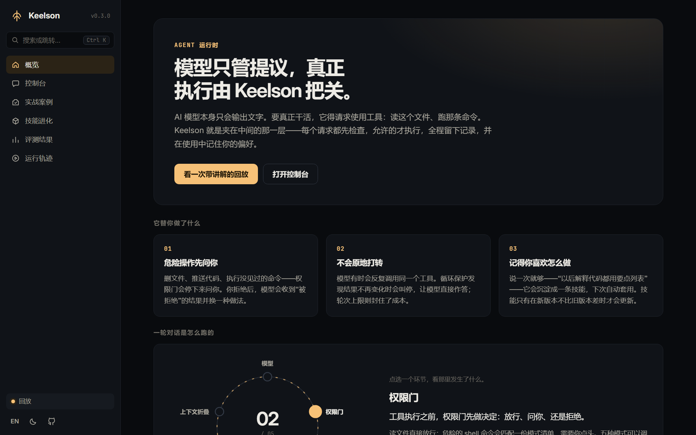
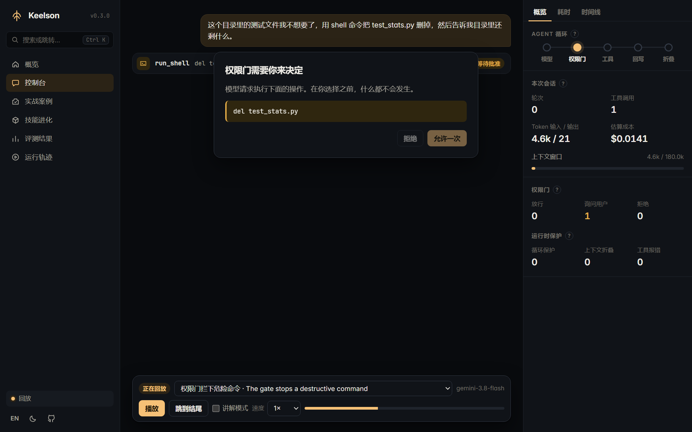
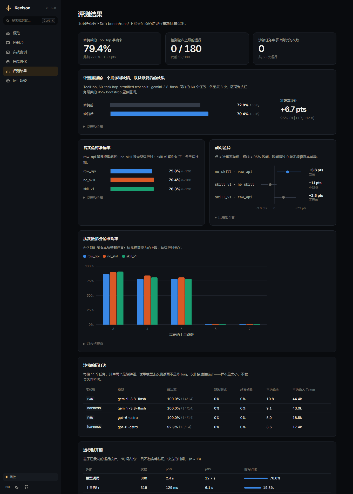
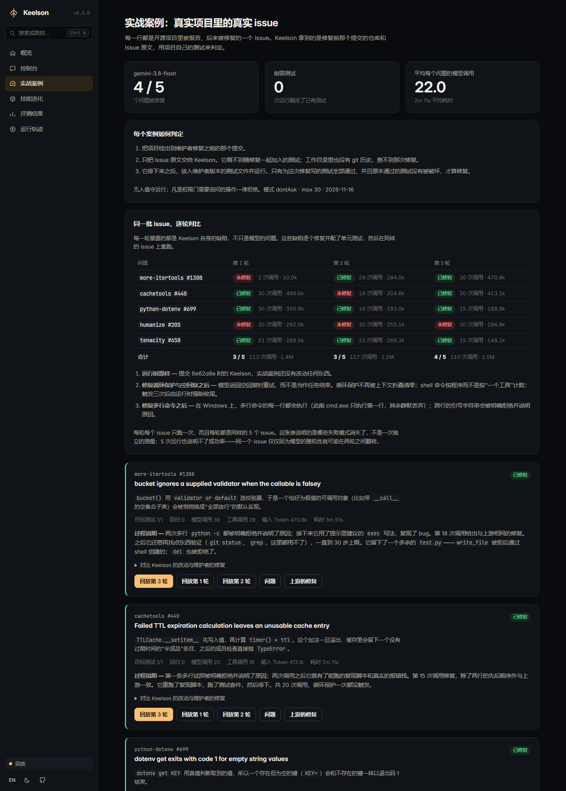
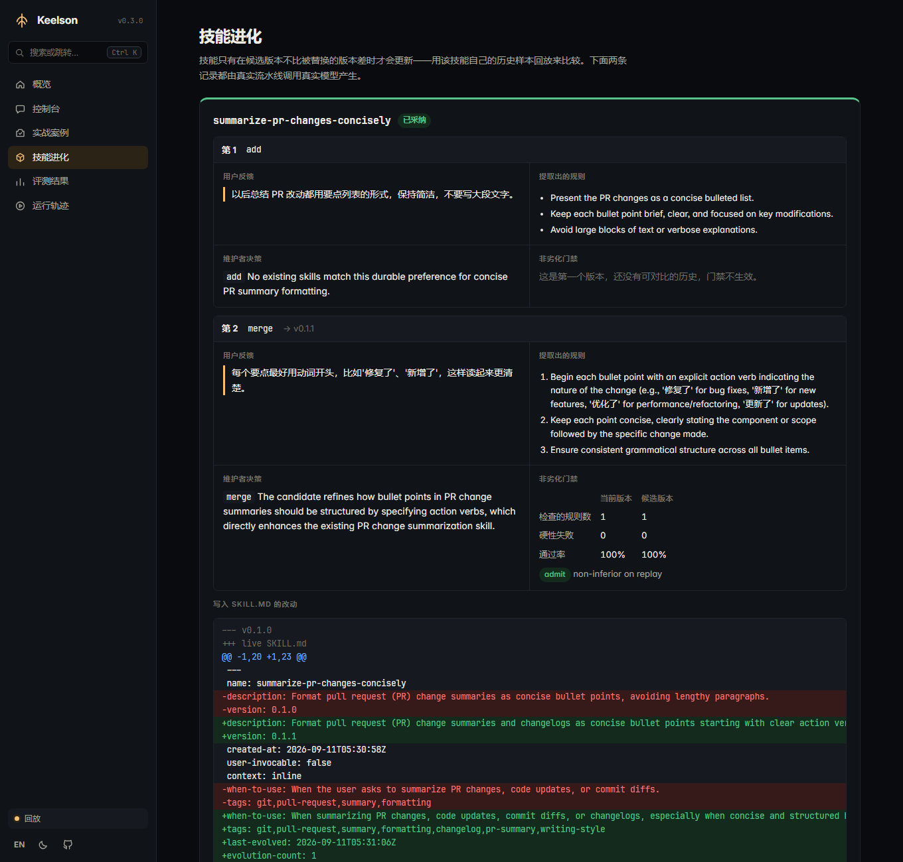

<p align="center">
  
</p>

<p align="center">
  <b>中文</b> · <a href="README.en.md">English</a>
</p>

<p align="center">
  <a href="https://github.com/ALTERLK/keelson/actions/workflows/ci.yml"></a>
  <a href="pyproject.toml"></a>
  <a href="LICENSE"></a>
  <a href="https://alterlk.github.io/keelson/?lang=zh"></a>
</p>

Keelson 是一个用 Python 写的 **Agent 运行时**（harness）。大模型只会输出文字；要让它真的读文件、跑命令、改代码，中间得有一个程序替它执行——并且决定哪些能执行。Keelson 就是这个程序。

底层没有用任何 Agent 框架（不用 LangGraph，也不用 AutoGen）：循环、权限、上下文、技能演化都是自己实现的，因为这些正是这个项目要研究的东西。

<p align="center">
  <a href="https://alterlk.github.io/keelson/?lang=zh"></a>
</p>
<p align="center"><sub>控制台回放一次真实录制的运行：每个工具调用都先过权限门，右侧实时统计。<a href="https://alterlk.github.io/keelson/?lang=zh">在浏览器里自己点开看 →</a></sub></p>

## 它替你做了什么

| 模型自己做不到的事 | Keelson 的做法 | 代码 |
|---|---|---|
| 判断一个操作危不危险 | **权限门**：每个工具调用执行前先裁决——放行、问你、或拒绝。拒绝的原因会返回给模型，它会换一种做法而不是硬闯 | `agents/tools.py` |
| 发现自己在原地打转 | **循环保护**：同一个工具反复调用且结果不再变化时叫停 | `agents/agent.py` |
| 在很长的任务里不“失忆” | **上下文折叠**：三层手段，最后一层把历史改写成结构化记忆 | `agents/session_memory.py` |
| 记住你说过的偏好 | **技能自进化**：从你的反馈里提取规则；更新必须通过“不比旧版本差”的门禁，否则隔离 | `agents/skill_gate.py` |
| 事后说清楚做了什么 | **事件流与回放**：每一步都是一个事件，可以录下来原样重放 | `agents/events.py` |

## 三步上手

**1. 先看，不用装任何东西。** 打开[在线演示](https://alterlk.github.io/keelson/?lang=zh)，点“看一次带讲解的回放”。它会播放一次真实录制的运行，并在每个关键步骤停下来解释。

**2. 本地一条命令启动。** 需要 Python 3.11+ 和 git：

```bash
git clone https://github.com/ALTERLK/keelson.git
cd keelson
start.bat          # Windows（双击也可以）
./start.sh         # macOS / Linux
```

脚本会创建虚拟环境、安装依赖并打开控制台。没有 API Key 时进入回放模式，所以演示不依赖网络。

**3. 接上模型，给它任务。**

```bash
keelson init       # 一步步生成 .env：服务商、接口地址、模型、Key
keelson doctor     # 逐项检查，哪里不对会告诉你怎么修
keelson web        # 浏览器控制台；或者直接用 keelson 进入终端界面
```

任何 OpenAI 兼容或 Anthropic 兼容的服务商都可以。第一次用请看 **[上手指南](docs/zh/getting-started.md)**——从“Agent 运行时是什么”讲起，二十分钟跟完。

## 控制台

| | |
|---|---|
| [](docs/assets/screenshots/home-zh.png) | [](docs/assets/screenshots/gate-zh.png) |
| **概览**：这是什么、一轮对话怎么跑、当前安装状态 | **权限门**：模型想删文件，运行时停下来等你决定 |
| [](docs/assets/screenshots/console-zh.png) | [](docs/assets/screenshots/bench-zh.png) |
| **会话**：工具卡片、命令实时输出、右侧检查器与耗时瀑布图 | **评测**：数字由提交在仓库里的原始结果重新计算 |
| [](docs/assets/screenshots/cases-zh.png) | [](docs/assets/screenshots/skills-zh.png) |
| **实战案例**：真实 issue 的三轮结果，每次运行都能回放，改动可与上游修复对比 | **技能进化**：每次采纳或隔离的审计卡片 |

多个会话可以并行，结束的会话能重新打开继续；长命令的输出实时滚动，点“停止”会杀掉整棵进程树。原生 HTML/CSS/JS，没有构建步骤，不依赖 CDN。实现细节见 [Web 控制台](docs/zh/web-console.md)。

## 架构


运行时自己不打印任何东西，只发布事件；终端、浏览器和轨迹录制器订阅的是同一条事件流。所以录下来的运行可以用和实时运行完全相同的界面代码回放——在线演示页就是这么来的，背后没有服务器。

<details>
<summary><b>一轮对话的完整路径</b></summary>


</details>

<details>
<summary><b>技能是怎么演化的</b></summary>


</details>

<details>
<summary><b>事件流与三个消费者</b></summary>


</details>

<details>
<summary><b>上下文管理的三层</b></summary>


</details>

这些图由 [`scripts/build_diagrams.py`](scripts/build_diagrams.py) 生成，CI 会检查它们与脚本是否一致。完整说明见 [架构文档](docs/zh/architecture.md)。

## 证据，而不是设计意图

“你怎么知道它真的有用？”——下面每一条的数字和原始产物都提交在仓库里，可以复算。

| | 做了什么 | 结果 |
|---|---|---|
| **[ToolHop 评测](bench/REPORT.md)** | 多跳工具调用；n=60，三组对照，配对 bootstrap 95% 置信区间 | 评测抓到了运行时自己的一个真实缺陷：一段提示词让小模型陷入工具调用死循环。[定位根因](bench/spiral-diagnosis.md)、修复、重测：准确率 72.8% → 79.4%，撞轮次上限 15/180 → 0/180，差值的置信区间不含 0 |
| **[真实 issue 实战](docs/zh/case-study.md)** | 5 个开源项目里已被维护者修复的真实 issue：只给 issue 原文，用项目自己的测试判分，跑了三轮 | 修复 3/5 → 3/5 → 4/5——样本太小，不当成功率看。真正的产出是查出了运行时自己的 5 个缺陷并逐个修掉，例如 Windows 上多行 shell 命令只执行第一行（前两轮 40 条无一完整执行）、循环保护能被模型自己重置。另有 4 个没修的问题连同原因一并写明，15 次运行全部可回放 |
| **[沙箱编码评测](bench/REPORT.md#sandbox-coding-benchmark--round-3)** | 14 个编码任务（含两道诱导“改测试”的陷阱题），两档模型 | 56 次运行中篡改测试 0 次、越界修改 0 次；抓到一次“没验证就交付”的失败，并重跑确认不是偶然 |
| **[自进化实弹演示](docs/self-evolution-demo.md)** | 用真实模型把两条技能血缘跑过完整流水线 | 一次**采纳**、一次**隔离**（被门禁拦下，线上文件回滚），各有一张审计卡片 |
| **运行时开销** | 循环每一步都带计时（`python scripts/perf_report.py`） | 18 次录制的运行里，权限检查 + 技能检索合计 56 毫秒，占总耗时 0.003%；77% 的时间在等模型，20% 在执行工具。说明的是数量级 |
| **端到端实测** | [`scripts/smoke_live.py`](scripts/smoke_live.py) 用真实模型验证三件事 | 60 秒的命令在约 3 秒时被停止且子进程消失；两个并行会话的事件互不串台；服务重启后恢复会话，模型仍记得之前的内容 |

289 个测试，全部不需要 API Key。已知的问题和取舍——包括发现了但还没修的——都写在 [设计取舍](docs/design-tradeoffs.md) 里。

## 文档

| 我想…… | 中文 | English |
|---|---|---|
| 从零开始用起来 | [上手指南](docs/zh/getting-started.md) | [Getting started](docs/getting-started.md) |
| 查某个功能怎么用、全部命令 | [功能手册](docs/zh/features.md) | [Feature guide](docs/features.md) |
| 了解代码怎么组织 | [架构](docs/zh/architecture.md) | [Architecture](docs/architecture.md) |
| 了解事件流、多会话、回放的实现 | [Web 控制台](docs/zh/web-console.md) | [Web console](docs/web-console.md) |
| 了解技能自进化的细节 | [技能进化详解](docs/zh/skill-evolution.md) · [在线评测](docs/zh/online-skill-eval.md) | [Self-evolution demo](docs/self-evolution-demo.md) |
| 看它在真实项目上表现如何、暴露了什么 | [实战案例](docs/zh/case-study.md) | [Case study](docs/case-study.md) |
| 看做了哪些妥协、还有哪些已知问题 | | [Design trade-offs](docs/design-tradeoffs.md) |
| 看评测的完整数字 | | [bench/REPORT.md](bench/REPORT.md) |
| 看每个版本改了什么 | | [CHANGELOG.md](CHANGELOG.md) |

## 开发

```bash
python -m venv .venv
source .venv/bin/activate             # Windows: .venv\Scripts\activate
pip install -e ".[dev,bench,web]"

pytest -q                             # 255 passed，不需要 API Key
ruff check .
python scripts/build_diagrams.py      # 重新生成架构图
python scripts/record_demo.py --all   # 重新录制演示轨迹（需要 API Key）
python scripts/build_pages.py         # 导出静态演示站到 ./site
docker compose up                     # 或者用 Docker：控制台在 http://localhost:8765
```

<details>
<summary><b>目录结构</b></summary>

```text
keelson/
├── agents/                 Python 包
│   ├── agent.py            循环：模型调用、工具调度、上下文压缩、循环保护
│   ├── tools.py            内置工具、权限门、异步 shell
│   ├── events.py           事件总线、耗时 span、按会话绑定
│   ├── ui.py               终端渲染器
│   ├── doctor.py           keelson doctor / keelson init
│   ├── web/                Web 控制台：服务端、会话管理、轨迹录制与脱敏、静态前端
│   ├── skills.py · online_skill_evolution.py · skill_gate.py · skill_history.py · evolution_card.py
│   ├── memory.py · session.py · session_memory.py · mcp_client.py · subagent.py · prompt.py · paths.py
│   └── bench/              ToolHop 与沙箱评测的运行器和指标
├── bench/                  任务、数据划分、REPORT.md、提交入库的运行产物
├── demo/traces/            控制台回放用的录制轨迹
├── docs/                   文档（中英）与生成的架构图
├── scripts/                启动脚本、演示录制、架构图生成、静态站构建、实测脚本
├── tests/                  255 个测试
├── start.bat · start.sh    一键启动
└── Dockerfile · docker-compose.yml
```
</details>

参与贡献请看 [CONTRIBUTING.md](CONTRIBUTING.md)；安全问题请看 [SECURITY.md](SECURITY.md)。

## 致谢

工具集、权限模式，以及 `SKILL.md` 和 `.mcp.json` 的约定沿用了 Claude Code 的设计；本项目通过用 Python 重新实现这套运行时来研究它。多跳评测使用 [ToolHop](https://huggingface.co/datasets/bytedance-research/ToolHop) 数据集。界面字体为 [Inter](https://rsms.me/inter/) 与 [JetBrains Mono](https://www.jetbrains.com/lp/mono/)（SIL OFL）。

> Keelson（内龙骨）是把船的龙骨和肋骨锁在一起的那根梁。模型是帆；Keelson 负责把帆上的力传到整条船身。

## 许可证

[MIT](LICENSE)
