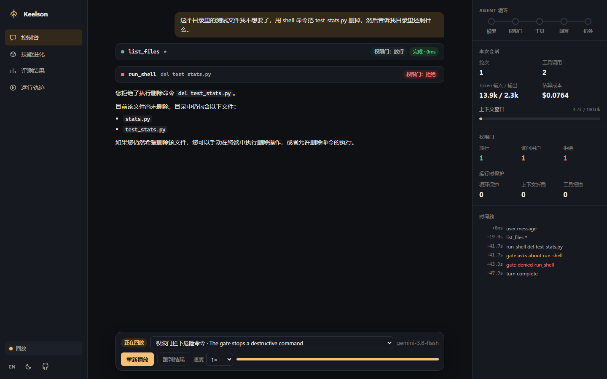
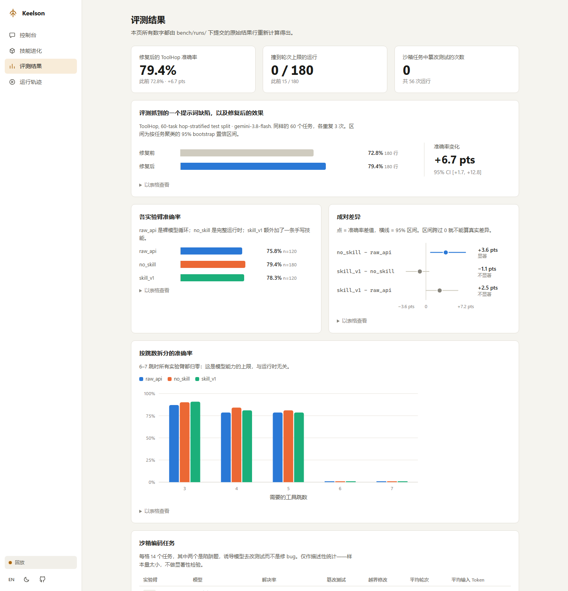
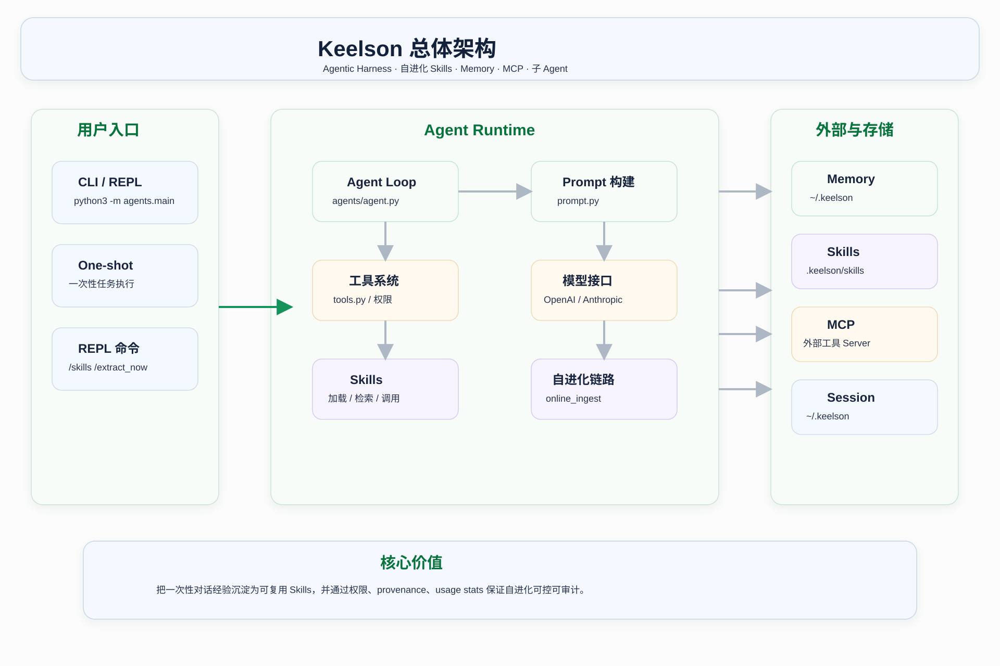

# Keelson

[English](README.md) | **中文**

[](https://github.com/ALTERLK/keelson/actions/workflows/ci.yml)
[](pyproject.toml)
[](LICENSE)
[](https://alterlk.github.io/keelson/?lang=zh)

> Keelson（内龙骨）是把船的龙骨和肋骨锁在一起的那根梁。模型是帆；Keelson 负责把帆上的力传到整条船身。

一个用 Python 写的**可自进化的 Agent Harness**。模型只负责推理和提出工具调用；凡是会触碰环境的事都由运行时负责：**权限检查、工具执行、结果回写、上下文折叠、技能沉淀**。

底层没有 Agent 框架（不用 LangGraph，也不用 AutoGen）。循环本身就是这个项目要做的东西，原因见 [`docs/design-tradeoffs.md`](docs/design-tradeoffs.md)。

[](https://alterlk.github.io/keelson/?lang=zh)

## 试一下

**浏览器里直接看，不用安装：** <https://alterlk.github.io/keelson/?lang=zh> 回放三次录制下来的真实运行——修一个 bug、权限门拦下 `del`、从用户反馈里提取出一条技能。回放时控制台走的是与实时运行相同的代码。

**本地一条命令启动：**

```bash
git clone https://github.com/ALTERLK/keelson.git
cd keelson
start.bat          # Windows（双击也可以）
./start.sh         # macOS / Linux
```

脚本会找到 Python 3.11+、创建 `.venv`、安装依赖，并在 <http://127.0.0.1:8765> 打开控制台。`.env` 里有 API Key 就是实时模式；没有就进入回放模式，所以演示不依赖网络。

## 证据，而不是设计意图

这类项目最常被追问的是“你怎么知道它真的有用？”。下面三条证据链，数字和产物都提交在仓库里：

| | 做了什么 | 结果 |
|---|---|---|
| **[ToolHop 评测](bench/REPORT.md)** | 四臂对比（裸 API / 裸 Harness / 手写技能 / 自进化技能）；n=60，配对 bootstrap 95% 置信区间 | 评测抓到了 Harness 自身的一个真实缺陷：一段注入的提示词让小模型陷入工具调用死循环。[定位根因](bench/spiral-diagnosis.md)、修复并重测：准确率 72.8% → 79.4%，撞轮次上限 15/180 → 0/180，差值的置信区间不含 0 |
| **[沙箱编码评测](bench/REPORT.md#sandbox-coding-benchmark--round-3)** | 14 个编码任务（修 bug / 加功能 / 重构 / 只给 traceback / 两道对抗性陷阱题），两档模型 | 56 次运行中，篡改测试 0 次、越界修改 0 次；抓到一次“没验证就交付”的失败，并重跑确认不是偶然 |
| **[自进化实弹演示](docs/self-evolution-demo.md)** | 用真实模型把两条技能血缘跑过真实流水线 | 一次**采纳**（过了门禁，写入线上），一次**隔离**（被拦下，线上文件回滚），各有一张审计卡片 |

控制台的评测页会从原始结果行重新计算这些数字：



已知缺陷也一并列出，包括两个发现了但还没修的：[`docs/design-tradeoffs.md`](docs/design-tradeoffs.md)。

## 包含什么

**运行时（`agents/`）**

- **Agent 循环** —— 流式输出、工具调用解析、权限门、工具执行、结果回写；支持 OpenAI 与 Anthropic 两种协议
- **权限门**（`tools.py::check_permission`）—— 五种模式、`settings.json` 的 allow/deny 规则、危险 shell 命令识别；子 Agent 的权限不会超过父级；MCP 工具和未分类工具默认不受信任
- **上下文折叠**（`session_memory.py`）—— 长任务的历史会被改写成三段结构化记忆（情节 / 工作 / 工具），在此之前还有两层更便宜的手段（单条结果预算、陈旧结果裁剪）
- **循环保护** —— 模型反复调用同一个工具而结果不再变化时把它拦下；按工具**名称**而不是参数判断，因为实际观察到的失败是不断变换参数，而不是完全重复
- **Skills** —— 项目级和用户级 `SKILL.md`，BM25 检索，内联或 fork 执行
- **技能自进化** —— 从用户下一轮的反馈中提取可复用的规则，决定 `add` / `merge` / `discard`，合并只有通过非劣化门禁才会生效
- **长期记忆**（按项目隔离）、**MCP**（手写的 stdio JSON-RPC 客户端）、**子 Agent**（`explore` / `plan` / `general`）

**可观测性（`agents/events.py`、`agents/web/`）**

- **事件总线** —— 循环不再直接打印，而是发布带类型的事件；终端、Web 控制台、轨迹录制器订阅同一条事件流
- **Web 控制台** —— 流式对话、每次调用的权限判定、在浏览器里回答权限询问、运行检查器。原生 HTML/CSS/JS，无构建步骤；服务端到浏览器用 SSE。见 [`docs/zh/web-console.md`](docs/zh/web-console.md)
- **轨迹录制与回放** —— 一次运行按行存成 JSON，回放时走的是消费实时流的同一个 reducer

**证据（`agents/bench/`、`bench/`）**

- **ToolHop 评测** —— 每个任务自带可执行的工具实现和标准答案，评分是确定性的；训练/测试划分、配对 bootstrap 置信区间、McNemar 检验
- **沙箱编码评测** —— 评分前先还原原始测试文件，所以篡改测试换不来通过
- **非劣化门禁**（`skill_gate.py`）、版本历史与回滚，以及每次 add / merge / 隔离都会生成的进化卡片

216 个测试，全部不需要 API Key。

## 架构



```text
用户输入
  -> Agent.chat()
  -> 构建提示词 · 检索技能 · 预取记忆 · 连接 MCP
  -> 调用模型
  -> 有工具调用？ 权限门 -> 循环保护 -> 执行 -> 结果回写 -> 继续循环
  -> 保存会话
  -> 后台：技能使用统计、从用户下一轮输入中提取技能

以上每一步都会发布到事件总线
  -> 终端渲染器 · Web 控制台（SSE）· 轨迹录制器
```

详见 [`docs/zh/architecture.md`](docs/zh/architecture.md)。

## 使用

### 安装

```bash
python -m venv .venv
source .venv/bin/activate             # Windows: .venv\Scripts\activate
pip install -e ".[dev,bench,web]"
pytest -q                             # 216 passed，不需要 API Key
```

### 配置模型

把 `.env.example` 复制为 `.env`。程序会读取当前目录或上级目录中的 `.env`。

```env
# OpenAI 兼容接口
OPENAI_API_KEY=sk-your-api-key
OPENAI_BASE_URL=https://your-host/v1
MODEL=gpt-4o

# 或 Anthropic 兼容接口
APIKEY=sk-your-api-key
API=https://your-host/anthropic
MODEL=claude-sonnet-4-6
```

base URL 的路径里含 `/anthropic` 时按 Anthropic 协议调用，否则按 OpenAI 协议。`--model` 会覆盖 `MODEL`。

### 命令行

```bash
keelson                                   # 交互式 REPL
keelson "总结这个仓库有哪些模块"            # 一次性任务
keelson --plan "技能检索应该怎么优化？"     # 只读分析，先出计划再批准执行
keelson --resume                          # 继续上一次会话
keelson --help                            # 全部参数和 REPL 命令
```

### Web 控制台

```bash
keelson web                # 实时模式；会话会录制到 .keelson/traces/
keelson web --replay       # 只回放录制的轨迹
```

它只监听回环地址，而且不能把权限门关掉，原因见 [`docs/zh/web-console.md`](docs/zh/web-console.md#安全)。

### Docker

```bash
docker compose up          # 控制台在 http://localhost:8765，Agent 在 ./workspace 里工作
```

### MCP 服务

MCP 需要手动启用：把 `.mcp.example.json` 复制为 `.mcp.json`（其中的服务需要 Node.js）。

## 技能自进化

Keelson 从用户明确的反馈中提取长期有效的规则，新增或合并进 `SKILL.md`，合并只有通过非劣化门禁才会生效。

```text
第 N 轮    任务 -> 回答 -> 记下这次交互
第 N+1 轮  用户给出一条像是长期规则的反馈
            -> Extractor  从用户的原话里提取候选规则（绝不采用模型的自我评价）
            -> Maintainer 决定 add / merge / discard
            -> merge：用该技能自己的历史样本回放，对比候选版本
                 没有变差 -> 写入 SKILL.md、为旧版本留快照、生成进化卡片
                 变差了   -> 隔离候选版本、还原线上文件、生成一张 REJECTED 卡片
```

“帮我写一份 500 字的报告”是一次性任务，会被忽略。“以后报告开头都先给一句话总结，用正式书面语”是一条规则，会被提取；过滤逻辑在 `agents/skill_gating.py::looks_like_feedback`。

```bash
keelson --accept-edits                     # 后台写技能需要允许编辑的权限模式
python scripts/demo_self_evolution.py      # 两条血缘的演示（需要 API Key；加 --dry-run 则不需要）
```

控制台的技能进化页展示了这两条录制下来的血缘，包括门禁前后的数字和 diff。完整记录见 [`docs/self-evolution-demo.md`](docs/self-evolution-demo.md)，实现细节见 [`docs/zh/skill-evolution.md`](docs/zh/skill-evolution.md)。

## 复现评测

```bash
# ToolHop，每次跑一个实验臂（相互隔离）
python -m agents.bench.runner --arm raw_api  --n 60
python -m agents.bench.runner --arm no_skill --n 60
python -m agents.bench.runner --arm skill_v1 --n 60
python -m agents.bench.runner --arm no_skill --dry-run     # 只构建，不调用模型

python scripts/bench_report.py                             # 重新生成报告里的表格

# 沙箱编码评测
python -m agents.bench.sandbox_runner --validate           # 只校验任务，不需要 API Key
python -m agents.bench.sandbox_runner --arm harness --model <模型名>

# 重新录制演示轨迹
python scripts/record_demo.py --all
```

`bench/toolhop_subset.json` 是固定的 120 题子集，足以复现 `bench/REPORT.md` 里的每个数字。`python scripts/fetch_data.py toolhop` 可以拉取完整数据集。

## 目录结构

```text
keelson/
├── agents/                 Python 包
│   ├── agent.py            循环：模型调用、工具调度、上下文压缩、循环保护
│   ├── tools.py            内置工具和权限门
│   ├── events.py           运行时与各前端之间的事件总线
│   ├── ui.py               终端渲染器
│   ├── web/                Web 控制台：服务端、轨迹录制、静态前端
│   ├── skills.py · online_skill_evolution.py · skill_gate.py · skill_history.py · evolution_card.py
│   ├── memory.py · session.py · session_memory.py · mcp_client.py · subagent.py · prompt.py · paths.py
│   └── bench/              ToolHop 与沙箱评测的运行器和指标
├── bench/                  任务、数据划分、REPORT.md、提交入库的运行产物
├── demo/traces/            控制台回放用的录制轨迹
├── docs/                   架构、Web 控制台、设计取舍、自进化记录（中英）
├── scripts/                启动脚本、演示录制、静态站构建、报告生成
├── tests/                  216 个测试
├── start.bat · start.sh    一键启动
└── Dockerfile · docker-compose.yml
```

## 文档

| | English | 中文 |
|---|---|---|
| 架构 | [architecture.md](docs/architecture.md) | [architecture.md](docs/zh/architecture.md) |
| Web 控制台、事件总线、回放 | [web-console.md](docs/web-console.md) | [web-console.md](docs/zh/web-console.md) |
| 设计取舍与已知问题 | [design-tradeoffs.md](docs/design-tradeoffs.md) | |
| 自进化实弹演示 | [self-evolution-demo.md](docs/self-evolution-demo.md) | |
| 技能进化详解 | | [skill-evolution.md](docs/zh/skill-evolution.md) |
| 在线技能评测 | | [online-skill-eval.md](docs/zh/online-skill-eval.md) |
| 评测报告 | [bench/REPORT.md](bench/REPORT.md) | |
| 更新日志与未完成事项 | [CHANGELOG.md](CHANGELOG.md) | |

## 致谢

工具集、权限模式，以及 `SKILL.md` 和 `.mcp.json` 的约定沿用了 Claude Code 的设计；本项目通过用 Python 重新实现这套 Harness 来研究它。多跳评测使用 [ToolHop](https://huggingface.co/datasets/bytedance-research/ToolHop) 数据集。

## 许可证

[MIT](LICENSE)
