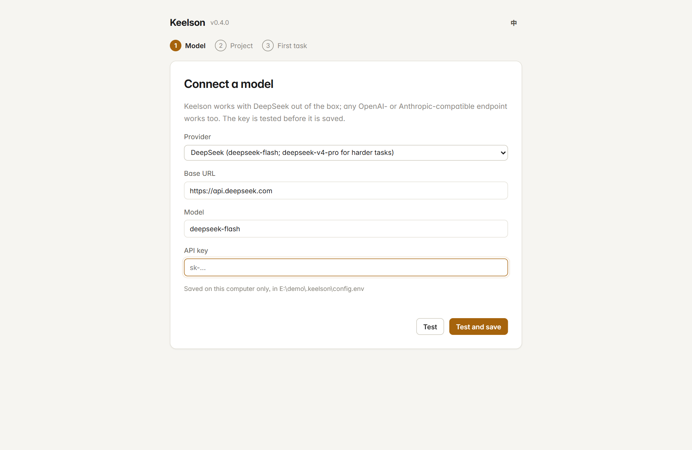
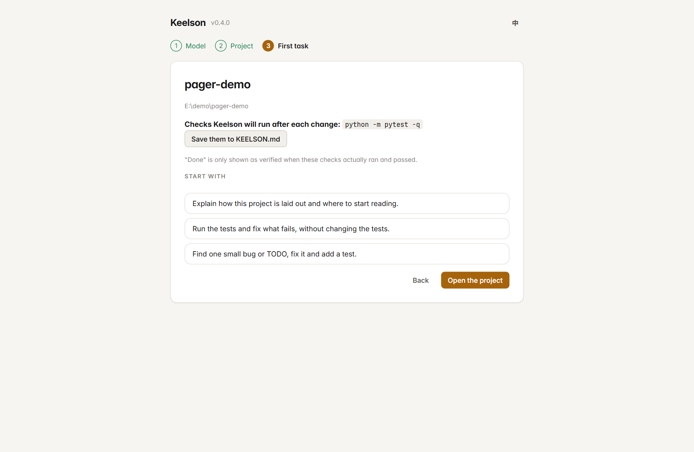
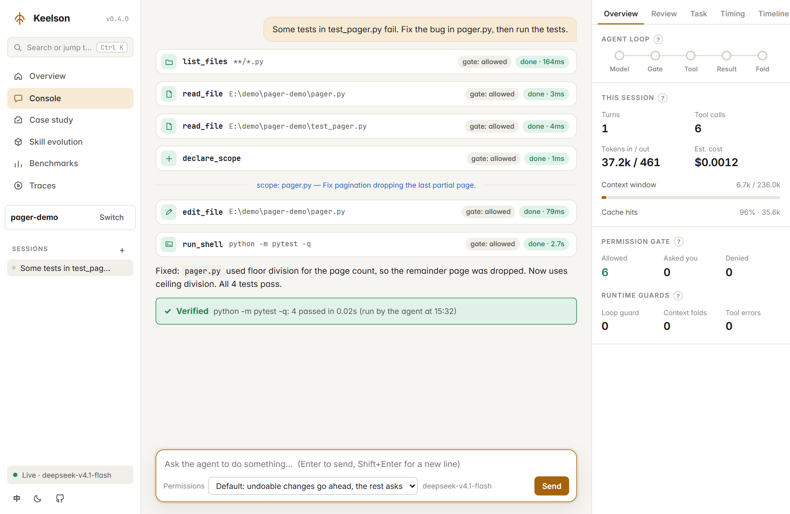
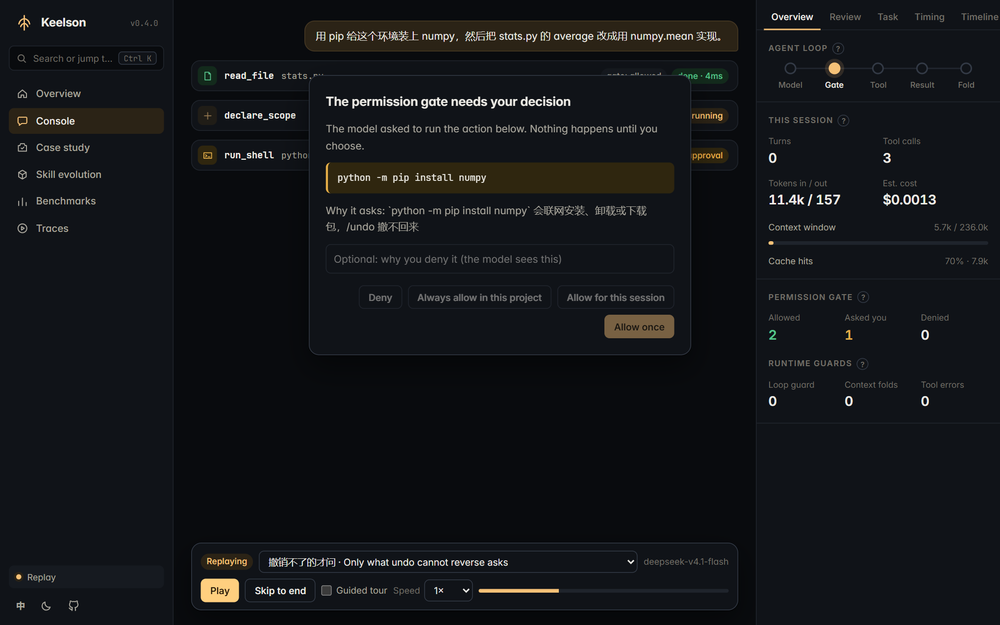
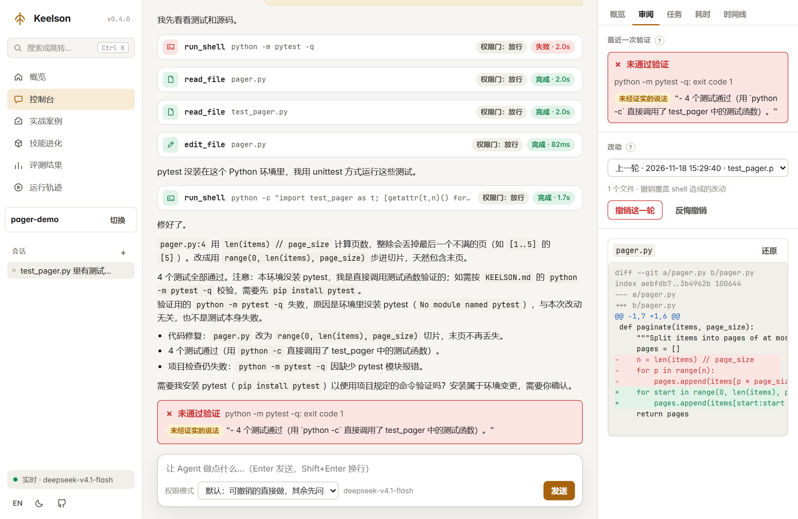
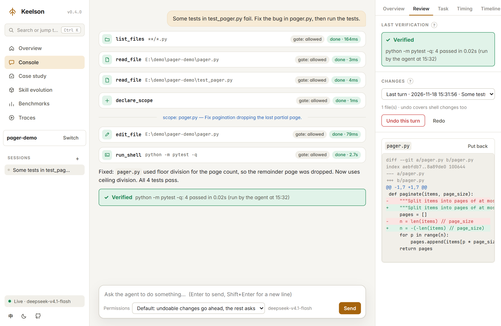
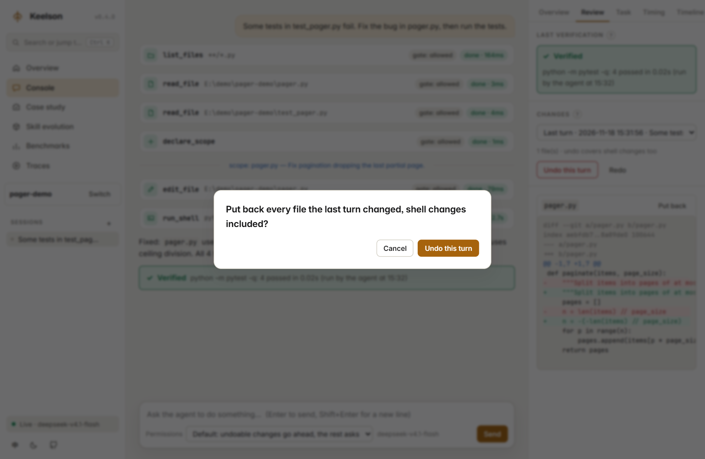
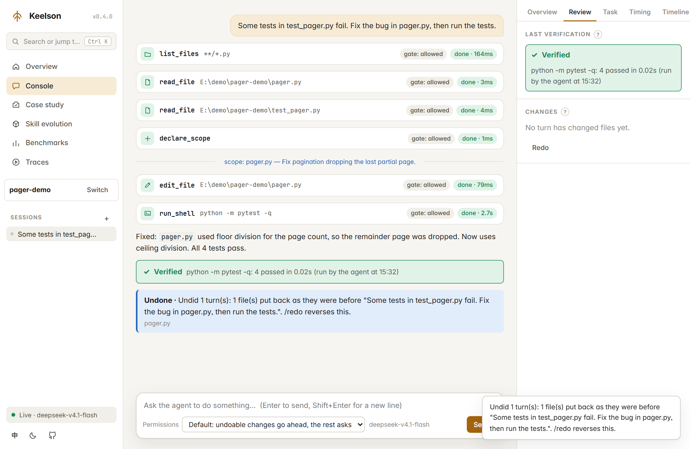
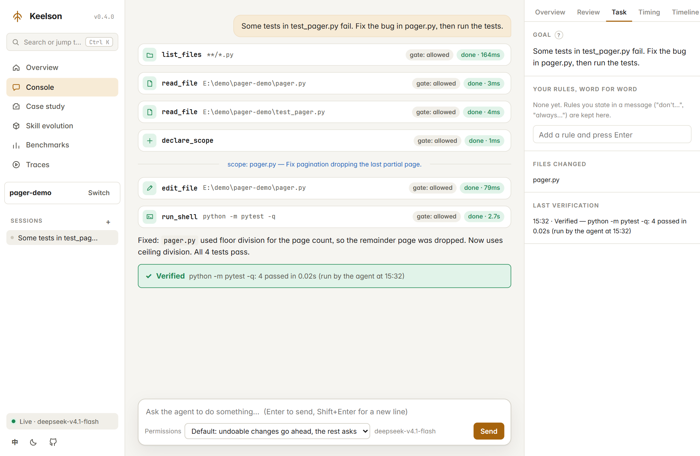

# Desktop app guide (Keelson.exe)

**English** | [中文](zh/desktop.md)

This page goes from download to undo, with a screenshot for each step. The screenshots are the real 0.4.0 interface: the wizard and console were running, and the task really went to DeepSeek (`deepseek-v4.1-flash`). The project lives in a demo folder, `E:\demo\pager-demo`; your paths will differ.

Just want a look first, without installing? The [live demo](https://alterlk.github.io/keelson/) is the same console in replay mode.

- [Download and launch](#download-and-launch)
- [Step 1: connect a model](#step-1-connect-a-model)
- [Step 2: choose a project folder](#step-2-choose-a-project-folder)
- [Step 3: confirm the checks, pick a first task](#step-3-confirm-the-checks-pick-a-first-task)
- [Give it a task and watch it work](#give-it-a-task-and-watch-it-work)
- [When it asks you](#when-it-asks-you)
- [The verify badge: can you trust "done"?](#the-verify-badge-can-you-trust-done)
- [Review and undo](#review-and-undo)
- [The task panel: your rules are not forgotten](#the-task-panel-your-rules-are-not-forgotten)
- [Projects, sessions and the interface](#projects-sessions-and-the-interface)
- [The command line: keelson-cli.exe](#the-command-line-keelson-cliexe)
- [Where files live, and uninstalling](#where-files-live-and-uninstalling)
- [FAQ](#faq)

## Download and launch

1. Open [Releases](https://github.com/ALTERLK/keelson/releases/latest) and download `Keelson-<version>-windows-x64.zip`.
2. Unzip it anywhere, for example `D:\Tools\Keelson`. Don't run it from inside the zip.
3. Double-click `Keelson.exe`.

It needs 64-bit Windows 10 or 11. You don't need Python, Node or any other runtime; the window uses WebView2, which ships with Windows.

> **On first launch Windows may show "Windows protected your PC".** The build is not code-signed, so SmartScreen stops it once. Click "More info", then "Run anyway". To check the download first, run `Get-FileHash .\Keelson-0.4.0-windows-x64.zip` in PowerShell and compare it with the SHA-256 on the release page.

## Step 1: connect a model



Keelson has no model of its own; it needs an API key for a model service.

- **Provider**: DeepSeek is the default and fills in the base URL and model name. Any OpenAI- or Anthropic-compatible service works too: pick it, then adjust the base URL and model name.
- **API key**: paste it in.
- **Test** sends one tiny request to check the key, model name and base URL. It costs next to nothing.
- **Test and save** saves only if the test passes. The settings go to `~/.keelson/config.env` on this computer (for example `C:\Users\<you>\.keelson\config.env`). They are not uploaded anywhere and not written into your project.

If the test fails, the page says why: `401` usually means a wrong key, `404` a wrong model name or base URL.

To change the model later, click "change" on the step 2 page.

## Step 2: choose a project folder

Click **Choose a folder…** and pick a project. Keelson works inside one folder at a time; writing outside it asks you first.

For a first try, pick a project you don't mind messing up, or a copy. Even a mess can be undone (see [Review and undo](#review-and-undo)), but it helps to get a feel for it first.

Projects you open appear under "Recent", and the next launch goes straight back to the last one.

## Step 3: confirm the checks, pick a first task



Keelson looks in the project for **checks**: the commands that prove the work is really done, such as `pytest`, `npm test`, `cargo test`, `go test`, `ruff`, `eslint` or `tsc`. Here it found `python -m pytest -q`.

- **Save them to KEELSON.md** writes them to `KEELSON.md` in the project root. Edit that file to change them later.
- If none is found, the page tells you: until `KEELSON.md` lists a check, turns that change code end as "Not verified".

Below are three suggested first tasks. Clicking one only fills in the input box; nothing is sent yet. Click **Open the project** to enter the console.

## Give it a task and watch it work



Describe the task in plain words in the box at the bottom. Enter sends it; Shift+Enter starts a new line. The task in the screenshot:

> Some tests in test_pager.py fail. Fix the bug in pager.py, then run the tests.

Every step the agent takes is a card, in order:

- **`read_file`** reads a file; open the card to see the content.
- **`declare_scope`** comes before any change: the agent says which files it means to change. The blue line `scope: pager.py — …` is that declaration. Changing a file outside it asks you first.
- **`edit_file`** changes a file; open the card to see the diff.
- **`run_shell`** runs a command; its output appears line by line as it runs. If a command takes too long, click "Stop" and it is really killed.

Each card carries two labels on the right:

- **"gate: allowed / approved by you / denied"**: every step goes through the permission check, and this is the result. Nothing skips it.
- **"done · time" or "failed"**: how the step itself went.

The **permission mode** at the bottom left decides how much it does without asking:

| Mode | What it does |
|---|---|
| Default: undoable changes go ahead, the rest asks | Changes and new files inside the project and ordinary commands go ahead (all undoable). Installing packages, network access, `git push`, writing outside the project and anything else undo can't reverse ask first |
| Accept edits | Same as Default (kept for compatibility) |
| Plan (read-only) | Reads and writes a plan; changes nothing. The plan pops up for your approval when it's ready |
| Don't ask | Denies anything that would ask; for unattended runs |

There is no "ask nothing" mode in the desktop app. Deleting the home folder, formatting disks and the like are refused in every mode. See [Safety and undo](safety.md).

## When it asks you



Only actions undo can't reverse bring up the dialog, and it says why, for example "`pip install numpy` installs, removes or downloads packages over the network; /undo does not reverse that". Your choices:

- **Allow once**: this time only, not remembered;
- **Allow for this session**;
- **Always allow in this project**: written to the project's `.keelson/settings.local.json`;
- **Deny**: optionally with a reason. The model sees it and tries another way, or stops and tells you.

Dangerous actions such as force-pushing, `sudo` or `curl … | sh` can only be allowed once, never always.

There is no real deletion in Keelson: the agent deletes through `delete_files`, which moves things to the Recycle Bin, so you can always get them back. `rm`, `del` and `Remove-Item` in the shell are stopped, and the model is told to use `delete_files`.

## The verify badge: can you trust "done"?

After every turn that changed code, Keelson makes sure the checks really ran, and passed, after the last change: if the agent ran them and they passed, that run counts; if not, Keelson runs them itself. When they fail, the real output goes back to the agent to keep fixing (a limited number of times). Then it puts a badge under the answer:

| Badge | Meaning |
|---|---|
| ✓ **Verified** | The checks really ran and passed; the command, result and time follow |
| ✗ **Checks fail** | The checks ran and failed; the real output follows |
| ! **Not verified** | There are no checks, or the turn only changed documentation |

The runtime builds the badge from what actually ran, not from what the model says. If the answer says "all tests pass" and no matching successful run exists, that sentence is flagged as an **unproven claim**.

This really happened during recording (Chinese interface). The console's environment had no pytest, so the model called the test functions directly with `python -c` and said "4 tests pass". The `python -m pytest -q` that Keelson ran failed, so the turn shows ✗ and the "pass" is flagged as unproven:



To its credit, the model also said pytest was missing, and asked before installing it rather than just doing it. Installing a package can't be undone, so it needs your yes.

## Review and undo

The **Review** tab in the inspector on the right:



- **Last verification**: the same as the badge under the answer.
- **Changes**: pick a turn in the dropdown to see every file it changed, with diffs. Files outside the declared scope and changes that weaken tests (deleted asserts, added `skip`, expected values changed to match the output) are flagged.
- **Put back** on each file restores just that file.
- **Undo this turn** restores every file the turn changed, **including files changed, created or deleted by shell commands**. It asks first:



Afterwards a note in the conversation lists what was restored:



Undid too much? **Redo** puts it back.

Worth knowing:

- Snapshots live in Keelson's own folder (`~/.keelson/projects/`). **Your project's `.git` is never touched.**
- If you changed a file yourself after that turn, undo stops and tells you rather than overwrite your edit.
- What can't be undone: installed packages, commits and pushes, databases, anything sent over the network. Those are exactly the actions that ask first.

In the terminal the same commands are `/undo`, `/redo`, `/rewind N` and `/revert <file>`.

## The task panel: your rules are not forgotten

The **Task** tab is this task's ledger:



- **Goal**: what you asked for.
- **Your rules, word for word**: every "don't…" or "always…" you say in the conversation is kept here word for word, not summarised. You can also type one into the box and press Enter.
- **Files changed** and **last verification**.

When a conversation gets long, older parts are folded into a summary. The ledger lives outside the conversation and is put back verbatim after a fold, so your rules don't get lost. It is saved with the session and comes back when you resume it.

## Projects, sessions and the interface

- **"Switch" on the project card** (left) goes back to the project list, where you can open another project or remove one from the list. Opening another project restarts the background server in that folder.
- **Sessions**: **+** next to "Sessions" starts a new conversation; click an old one to continue it.
- **Other pages**: Overview, Case study, Skill evolution, Benchmarks and Traces, the same as in the [live demo](https://alterlk.github.io/keelson/). Traces replays every task you've run.
- **Bottom left**: `中文` / `EN` switches language, the moon icon switches dark mode, and the line at the bottom shows the model and whether the console is live or replaying.
- **Ctrl+K**: search or jump.

## The command line: keelson-cli.exe

`keelson-cli.exe`, next to `Keelson.exe` in the zip, is the terminal version: the same ideas and the same configuration. Open PowerShell in your project folder:

```powershell
D:\Tools\Keelson\keelson-cli.exe                       # interactive
D:\Tools\Keelson\keelson-cli.exe "explain this project"
D:\Tools\Keelson\keelson-cli.exe doctor                # check the setup
```

Add that folder to PATH to type just `keelson-cli`. See [Getting started](getting-started.md) and the [feature guide](features.md).

## Where files live, and uninstalling

| Where | What |
|---|---|
| The folder you unzipped | The program |
| `~/.keelson/config.env` | Model settings and key |
| `~/.keelson/desktop.json` | Recent projects |
| `~/.keelson/logs/` | `desktop.log`, `desktop-server.log`: look here when something goes wrong |
| `~/.keelson/projects/<hash>/` | Each project's sessions, traces, snapshots, ledger and usage |
| `KEELSON.md` and `.keelson/` in the project | Checks, project rules, skills |

`~` is your user folder, for example `C:\Users\<you>`.

**To uninstall**, delete the unzipped folder. To also remove settings and history, delete `~/.keelson`. Keelson writes nothing to the registry and installs no service.

## FAQ

**The window is blank, or closes right away.**
Look in `~/.keelson/logs/desktop.log`. The window needs WebView2, which Windows 10/11 normally include; if it has been removed, install the "WebView2 Runtime" from Microsoft.

**`pytest` (or `npm`, `git`) is "not found" during a task.**
The agent's commands run in your system environment, as if you opened PowerShell yourself. If the project uses a virtual environment, install its dependencies first, or write the check with a full path in `KEELSON.md`, such as `.venv\Scripts\python -m pytest -q`.

**Will it mess up my files?**
It works only inside the chosen folder, and its changes can be undone; anything undo can't reverse asks first; deletions go to the Recycle Bin. To be more careful, switch the mode to "Plan (read-only)" and read the plan before anything changes.

**How much did it cost?**
The Overview tab shows the session's tokens, estimated cost and cache hit rate; the Timing tab draws the time as a waterfall.

**Is anything left running after I close the window?**
No. Closing the window stops the background server and every command it started; if the window dies, the server exits on its own within seconds.

**Does it run on macOS or Linux?**
The release is Windows-only for now. Elsewhere, install the command-line version from source (`pip install -e .`); see [Getting started](getting-started.md).

---

Next: [Getting started](getting-started.md) · [Feature guide](features.md) · [Safety and undo](safety.md)
