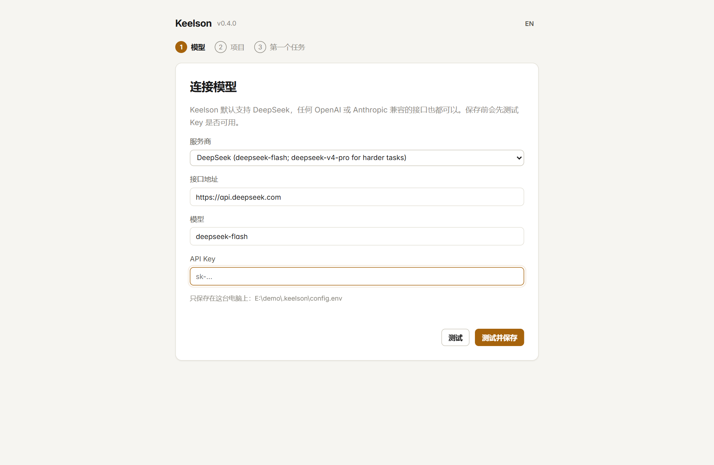
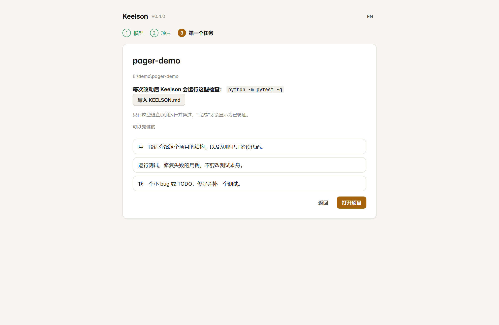
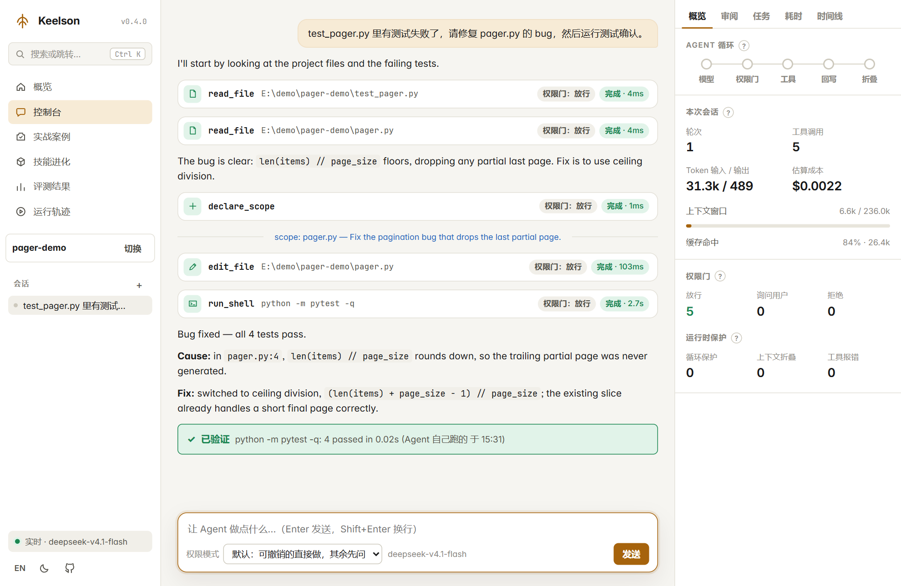
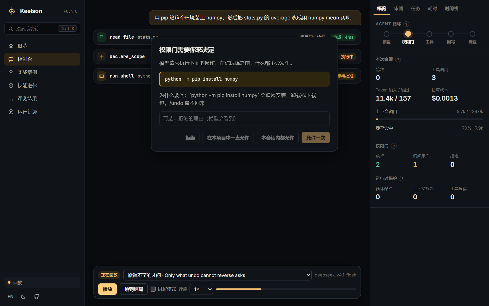
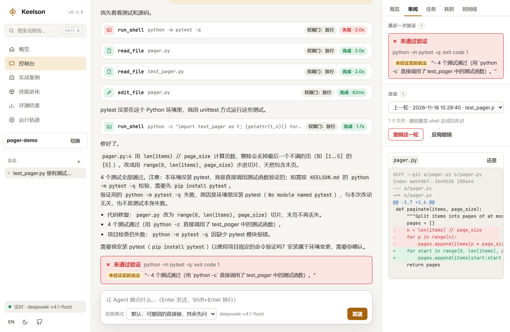
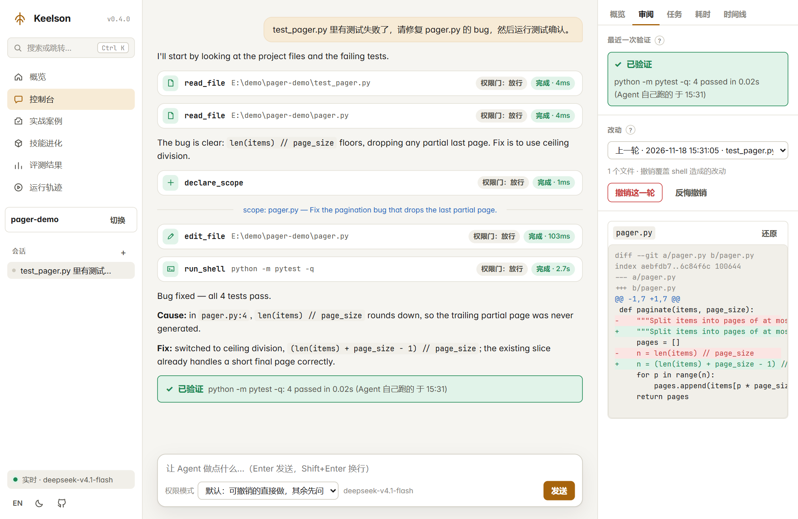
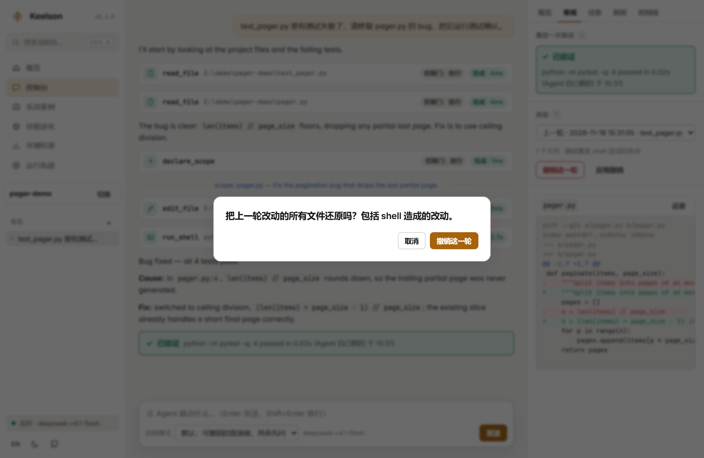
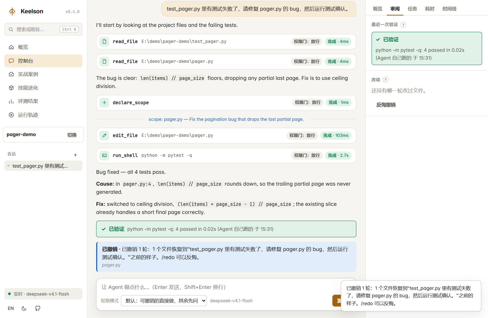
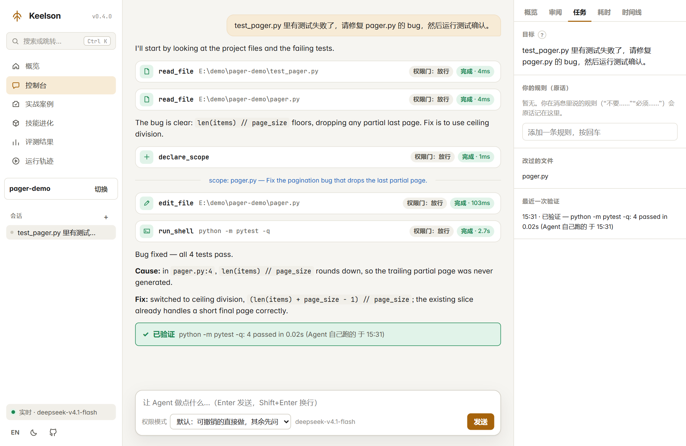

# 桌面版使用手册（Keelson.exe）

[English](../desktop.md) | **中文**

这一页从下载讲到撤销，每一步都配了截图。截图是 0.4.0 的真实界面：向导和控制台真的在运行，任务也真的交给了 DeepSeek（`deepseek-v4.1-flash`）。截图里的项目放在演示目录 `E:\demo\pager-demo`，和你电脑上的路径不同。

不想装任何东西、只想先看看？[在线演示](https://alterlk.github.io/keelson/)是同一个控制台的回放模式。

- [下载和启动](#下载和启动)
- [第一步：连接模型](#第一步连接模型)
- [第二步：选项目文件夹](#第二步选项目文件夹)
- [第三步：确认检查命令，选第一个任务](#第三步确认检查命令选第一个任务)
- [派任务、看它干活](#派任务看它干活)
- [它问你的时候](#它问你的时候)
- [验证徽章：它说“做完了”可不可信](#验证徽章它说做完了可不可信)
- [审阅和撤销](#审阅和撤销)
- [任务面板：你的规则不会被忘掉](#任务面板你的规则不会被忘掉)
- [切换项目、会话和界面](#切换项目会话和界面)
- [命令行版 keelson-cli.exe](#命令行版-keelson-cliexe)
- [文件存在哪里、怎么卸载](#文件存在哪里怎么卸载)
- [常见问题](#常见问题)

## 下载和启动

1. 打开 [Releases](https://github.com/ALTERLK/keelson/releases/latest)，下载 `Keelson-<版本>-windows-x64.zip`。
2. 解压到任意文件夹，比如 `D:\Tools\Keelson`。不要直接在压缩包里双击运行。
3. 双击 `Keelson.exe`。

需要 Windows 10 或 11（64 位）。不需要装 Python、Node 或别的运行时；窗口用的是 Windows 自带的 WebView2。

> **第一次运行时 Windows 可能弹出“Windows 已保护你的电脑”。** 安装包没有代码签名证书，SmartScreen 会拦一次。点“更多信息”，再点“仍要运行”。如果不放心，可以先核对 Release 页面上写的 SHA-256：在 PowerShell 里运行 `Get-FileHash .\Keelson-0.4.0-windows-x64.zip`，结果应该和页面上的一致。

## 第一步：连接模型



Keelson 自己不带模型，需要一个模型服务的 API Key。

- **服务商**：默认是 DeepSeek，接口地址和模型名会自动填好。任何 OpenAI 兼容或 Anthropic 兼容的服务也可以，选好后改接口地址和模型名即可。
- **API Key**：粘贴进去。
- **测试**：发一个很小的请求，看 Key、模型名和接口地址能不能用，几乎不花钱。
- **测试并保存**：测试通过才保存。保存在这台电脑上的 `~/.keelson/config.env`（例如 `C:\Users\<你>\.keelson\config.env`），不会上传到任何地方，也不会写进你的项目。

测试失败时，界面会写明原因：`401` 一般是 Key 不对，`404` 一般是模型名或接口地址不对。

以后想换模型，在第二步页面上点“更改”。

## 第二步：选项目文件夹

点 **选择文件夹…**，选一个项目文件夹。Keelson 一次只在一个文件夹里工作，读写都限制在这里；要写文件夹外的文件，会先问你。

第一次用，建议选一个不怕弄乱的项目，或者一份拷贝。其实弄乱了也能撤销（见[审阅和撤销](#审阅和撤销)），但先熟悉一下没坏处。

打开过的项目会出现在“最近打开”列表里，下次启动直接回到上次的项目。

## 第三步：确认检查命令，选第一个任务



Keelson 会在项目里找**检查命令**，也就是用来确认“真的做好了”的命令：`pytest`、`npm test`、`cargo test`、`go test`、`ruff`、`eslint`、`tsc` 等等。截图里找到的是 `python -m pytest -q`。

- 点 **写入 KEELSON.md**，把这些命令存进项目根目录的 `KEELSON.md`。以后想改，直接编辑这个文件。
- 没找到时会提示你：在 `KEELSON.md` 写上检查命令之前，改过代码的轮次都只会显示“未验证”。

下面是三个推荐的第一个任务。点一个只会把文字填进输入框，不会马上发出去。点 **打开项目** 进入控制台。

## 派任务、看它干活



在底部输入框里用平常的话描述任务，按 Enter 发送（Shift+Enter 换行）。截图里的任务是：

> test_pager.py 里有测试失败了，请修复 pager.py 的 bug，然后运行测试确认。

Agent 的每一步都是一张卡片，按时间往下排：

- **`read_file`**：读文件，点开能看内容。
- **`declare_scope`**：动手前先声明打算改哪些文件。下面那行蓝字 `scope: pager.py — …` 就是它的声明。之后改范围外的文件，要先问你。
- **`edit_file`**：改文件，点开能看 diff。
- **`run_shell`**：跑命令，输出实时一行行出现。命令跑太久可以点“停止”，会真的终止。

每张卡片右边都有两个标签：

- **“权限门：放行 / 你已批准 / 拒绝”**：这一步有没有经过检查、结果是什么。没有任何一步能绕过检查。
- **“完成 · 耗时”或“失败”**：这一步的执行结果。

输入框左下角的 **权限模式** 决定它可以不问你就做多少事：

| 模式 | 做什么 |
|---|---|
| 默认：可撤销的直接做，其余先问 | 项目内改文件、新建文件、普通命令直接做（都能撤销）；装包、联网、`git push`、写项目外的文件等撤不回的事先问你 |
| 自动接受改动 | 和默认相同（为兼容保留） |
| 计划（只读） | 只读文件、写方案，不改任何东西；方案写好后弹窗请你批准 |
| 不询问 | 需要问你的一律拒绝，适合无人值守 |

桌面版没有“什么都不问”的模式。删除、格式化磁盘、动主目录这类事，在任何模式下都会被拒绝。详见[安全与撤销](safety.md)。

## 它问你的时候



只有撤不回的操作才会弹出确认框，并写明原因，比如“`pip install numpy` 会联网安装、卸载或下载包，/undo 撤不回来”。你可以选：

- **允许一次**：只这一次，不会被记住；
- **本会话内都允许**；
- **在本项目中一直允许**：写进项目的 `.keelson/settings.local.json`；
- **拒绝**：可以写上理由，模型会看到，然后换个做法或停下来告诉你。

强推、`sudo`、`curl … | sh` 这类危险操作只能“允许一次”，永远不能一直允许。

Keelson 里没有真删除：Agent 删文件只能用 `delete_files`，东西进回收站，随时能找回来。shell 里的 `rm`、`del`、`Remove-Item` 会被拦下，并告诉模型改用 `delete_files`。

## 验证徽章：它说“做完了”可不可信

每一轮改过代码之后，Keelson 都要确认检查命令在最后一次改动之后真的跑过并通过：Agent 自己跑过并通过，就用那次的结果；没跑过，Keelson 自己跑。没通过时，真实输出会交还给 Agent 接着修（有次数上限）。最后在回答下面贴一个徽章：

| 徽章 | 意思 |
|---|---|
| ✓ **已验证** | 检查命令真的跑过并通过，后面写着命令、结果和时间 |
| ✗ **未通过验证** | 检查命令跑了但失败，后面附真实输出 |
| ! **未验证** | 没有检查命令，或者这一轮只改了文档 |

徽章由运行时根据真实执行记录生成，不看模型怎么说。如果模型的回答里写了“测试都通过了”，却找不到对应的成功运行记录，这句话会被标成 **未经证实的说法**。

下面是录制时真实发生的一次。当时控制台的环境里没装 pytest，模型改用 `python -c` 直接调用测试函数，然后说“4 个测试通过”。Keelson 跑的 `python -m pytest -q` 失败了，于是这一轮显示 ✗，那句“通过”被标成未经证实：



好在模型也如实说了 pytest 没装，并且没有自己去装，而是先问你。装包撤不回，所以要你点头。

## 审阅和撤销

右侧检查器的 **审阅** 标签页：



- **最近一次验证**：和回答下面的徽章一样。
- **改动**：在下拉框里选是哪一轮，下面列出那一轮改过的每个文件和 diff。范围外的文件、削弱测试的改动（删断言、加 `skip`、把期望值改成实际输出等）会单独标出来。
- 每个文件右上角有 **还原**，只还原这一个文件。
- **撤销这一轮**：把这一轮改过的所有文件还原，**包括 shell 命令改动、新建、删除的文件**。点了会先确认：



撤销后，对话里会出现一条说明，写着还原了哪些文件：



撤错了？点 **反悔撤销**，回到撤销之前的样子。

几点要知道的：

- 快照存在 Keelson 自己的目录里（`~/.keelson/projects/`），**不会碰你项目的 `.git`**。
- 如果那一轮之后你自己又改过某个文件，撤销会停下来告诉你，不会覆盖你的修改。
- 撤不回的事情：装好的包、提交和推送、数据库、发到网络上的东西。这些正是会先问你的操作。

命令行里对应的命令是 `/undo`、`/redo`、`/rewind N`、`/revert 文件`。

## 任务面板：你的规则不会被忘掉

**任务** 标签页是这次任务的账本：



- **目标**：你这次要它做的事。
- **你的规则（原话）**：你在对话里说过的“不要……”“必须……”会按原话记在这里，不做总结。也可以在输入框里直接加一条，按回车。
- **改过的文件**、**最近一次验证**。

对话很长时，旧内容会被压缩成摘要。账本放在对话之外，压缩之后原样放回去，所以你说过的规则不会因为压缩而丢掉。会话保存、下次恢复时，账本也一起恢复。

## 切换项目、会话和界面

- **左侧项目卡片的“切换”**：回到项目列表，打开别的项目，或从列表里移除。打开别的项目时，后台服务会在那个文件夹里重新启动。
- **会话**：左侧“会话”旁边的 **+** 新建一个对话；点历史会话可以接着聊。
- **其它页面**：概览、实战案例、技能进化、评测结果、运行轨迹，和[在线演示](https://alterlk.github.io/keelson/)里一样。运行轨迹里能回放你自己的每一次任务。
- **左下角**：`EN` / `中文` 切换语言，月亮图标切换深色模式，最下面一行显示当前模型和状态（实时 / 回放）。
- **Ctrl+K**：搜索或跳转。

## 命令行版 keelson-cli.exe

压缩包里 `Keelson.exe` 旁边的 `keelson-cli.exe` 是终端版，概念和桌面版一样，配置也共用。在项目文件夹里打开 PowerShell：

```powershell
D:\Tools\Keelson\keelson-cli.exe              # 进入交互界面
D:\Tools\Keelson\keelson-cli.exe "解释一下这个项目"
D:\Tools\Keelson\keelson-cli.exe doctor       # 检查配置
```

把那个文件夹加进 PATH 后，就能直接输入 `keelson-cli`。详见[上手指南](getting-started.md)和[功能手册](features.md)。

## 文件存在哪里、怎么卸载

| 位置 | 里面是什么 |
|---|---|
| 解压出来的文件夹 | 程序本身 |
| `~/.keelson/config.env` | 模型设置和 Key |
| `~/.keelson/desktop.json` | 最近打开的项目 |
| `~/.keelson/logs/` | `desktop.log`、`desktop-server.log`，出问题时看这里 |
| `~/.keelson/projects/<哈希>/` | 每个项目的会话、轨迹、快照、账本和用量 |
| 项目里的 `KEELSON.md`、`.keelson/` | 检查命令、项目规则、技能 |

`~` 指你的用户目录，比如 `C:\Users\<你>`。

**卸载**：删掉解压出来的文件夹即可。想连设置和历史一起清掉，再删 `~/.keelson`。Keelson 不写注册表，也不装服务。

## 常见问题

**双击后窗口是白的，或者一闪就没了。**
看 `~/.keelson/logs/desktop.log`。窗口靠 WebView2 显示，Windows 10/11 一般自带；如果被精简掉了，从微软官网装“WebView2 Runtime”。

**任务里跑 `pytest`（或 `npm`、`git`）报“找不到”。**
Agent 的命令在你的系统环境里运行，和你自己开 PowerShell 一样。如果项目用虚拟环境，先在项目里装好依赖；或者在 `KEELSON.md` 里把检查命令写成完整路径，比如 `.venv\Scripts\python -m pytest -q`。

**它会不会乱改我的文件？**
它只在选中的项目文件夹里工作，改动都能撤销；撤不回的操作会先问你；删除只进回收站。想更保守，把权限模式切到“计划（只读）”，先看方案再动手。

**花了多少钱？**
概览标签页显示本次会话的 Token 用量、估算花费和缓存命中率；“耗时”标签页把时间画成瀑布图。

**关了窗口，后台还有东西在跑吗？**
没有。关窗口会停掉后台服务和它启动的所有命令；窗口异常退出时，服务几秒内也会自己退出。

**能在 macOS 或 Linux 上用吗？**
发布包目前只有 Windows 版。其它系统可以从源码装命令行版（`pip install -e .`），见[上手指南](getting-started.md)。

---

接下来读什么：[上手指南](getting-started.md) · [功能手册](features.md) · [安全与撤销](safety.md)
